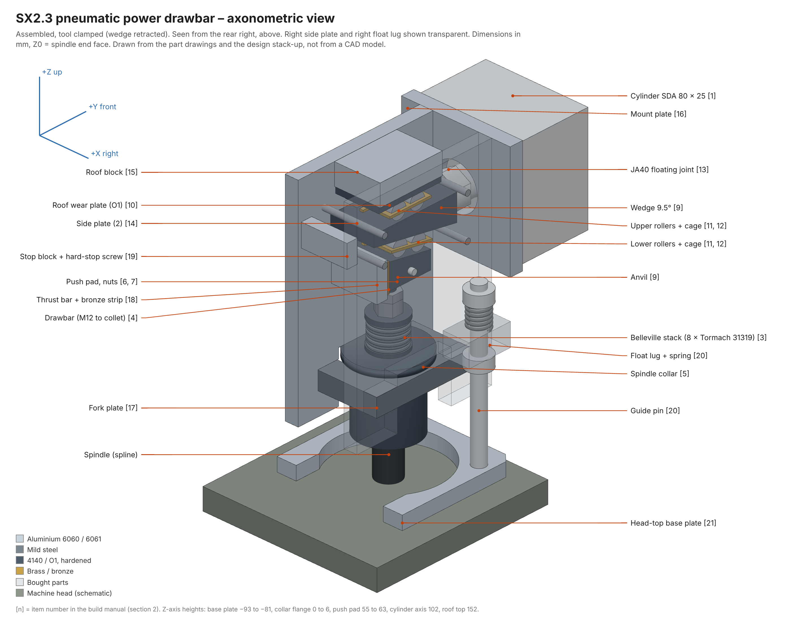

# SX2_3_Drawbar — pneumatic power drawbar for the Sieg SX2.3

A floating-housing, wedge-actuated Belleville-washer power drawbar for a CNC-converted Sieg SX2.3 (R8 spindle, TTS tooling, Centroid Acorn). Designed in a Claude chat, 25–30 Oct 2026.

## Design in one paragraph
A Belleville stack on a 7/16-20 drawbar holds the TTS holder. To release, an SDA 80×25 cylinder drives a 9.5° wedge (i ≈ 5.98) through Ø14 rollers onto an anvil that pushes the drawbar down. The cylinder, wedge and anvil sit in a **floating** aluminium housing whose fork reacts against a collar clamped to the spindle, so the release force closes inside the spindle and **puts no load on the spindle bearings**. The housing floats on two Ø12 h6 guide pins in bronze bushes on a 12 mm 6061 base plate screwed to the head top. Acorn logic inhibits spindle start while released and vice versa.

## Status (30 Oct 2026)
- Design: essentially complete — see `docs/design-doc.md` (export of the live doc, rev 483).
- Steel ordered (Edcon, 29 Oct): 4140 Ø16, Ø50 × 150, Ø65; Ø5 silver steel; O1 40 × 5.
- Purchased: SMC JA40-14-150 floating joint; SDA 80×25 cylinder on hand.
- Still to measure: JA fitted length (sets spacer length), pilot drill at M6 positions, spindle coast-down (9.12), Acorn spare I/O (9.13), collet/washer/release tests with the new 3/4" collet, head weight W (gas strut sizing).

## Key numbers
| Item | Value |
|---|---|
| Drawbar | 4140, M12 × 1.75 to the flat-nose collet (changed 7 Nov 2026), 7/16-20 top thread; 8.2 kN preload set by stack height |
| Collar | Two-piece 4140 clamp, Ø52 × 64, clamp screws at Z −25.5/−37.5/−49.5 to clear the 16 mm fork |
| Wedge | 4140, ~50 HRC, 80 × 40, 23.5 → 10.11, 9.5° |
| Rollers | Ø14 × 36 hardened dowels |
| Cylinder | LAIZE SDA 80×25, rod M14×1.5 female, 0.15–0.8 MPa |
| Floating joint | SMC JA40-14-150 (4.4 kN, ±0.75 mm, ±5°) |
| Frame | 6060 12 mm plates (12 × 160 bar); fork 16 mm mild steel |
| Added mass | ≈ 6.4 kg (floating part ≈ 4.9 kg) — gas strut ≥ 250 mm stroke |

## Layout
| Path | Contents |
|---|---|
| `docs/` | Printable design (docx + PDF, 14 Nov 2026), `design-doc.md` (full live design doc), `measurement-sheet.md` |
| `manual/` | Build manual (printed docx + PDF, 14 Nov 2026), `build-manual.md`, `gcode_gen.py` (G-code generator), `backplot.py`, `build_print_manual.py`, `img/` |
| `gcode/` | Centroid Acorn programs O1101–O2202 (G21, G54, lower-left zero, 5000 rpm cap) and `index.json` (setups, tools, tool-centre spans) |
| `calculator/` | `PDB_design_calculator.xlsx`, washer-stack comparison, `calc.py` / `build.py` that generate them |
| `drawings/axonometric/` | Axonometric view of the assembly (PNG) and the three.js source that renders it |
| `drawings/doc-media/` | Drawings and formula images used in the printed doc |
| `drawings/widgets/` | Renders of every diagram produced during the chat (chronological by file name) |
| `photos/` | Machine/cylinder photos used for measurements |
| `references/` | Belleville washer datasheet supplied during the chat |
| `chat/` | `CONTEXT.md` (engineering summary of the whole chat, incl. decisions, errors fixed and the user's messages), `conversation-opening.md` (verbatim first turns) |

## Live documents
The design doc and measurement sheet are live Claude Docs; the markdown here is a snapshot. Measurement sheet: https://claude.ai/artifact/RGh6ptAZkj2cLzY2MXC65X

## Sources
Sourced references (SIEG SX2.3 manual, SMC JA catalogue, Atlas 4140 data, Hoss / DJ Bird / Shane Wighton builds, Tormach TTS docs, DIN 2093) are listed in the References section of `docs/design-doc.md`.

## Plate part drawings (5 Nov 2026)
`drawings/plate-parts/` holds one dimensioned drawing per plate part (PNG and SVG), with every hole as x, y from 0,0 at the lower-left of its view: side plate, fork plate, base plate, mount plate, roof block, wear plate, thrust bar and bronze strip, stop block, float lug, roller cage. `generate_plate_drawings.py` regenerates them from the geometry; the same hole tables are in `docs/design-doc.md`.
