# SX2.3 Power Drawbar – Build Manual

Nov 14, 2026 · @Russell Brett

## 1. How to use this manual

This manual takes the power drawbar from bar stock to a commissioned machine. It follows the design in the *SX2.3 Power Drawbar – Design* doc (as of 7 Nov 2026), which stays the reference for why each dimension is what it is. Where the two disagree, the design doc wins; tell me and I'll correct this manual.

**Conventions**

- All dimensions in mm; angles in degrees. Tolerances ISO 2768-m unless stated.
- **Part coordinates (offset tables and G-code):** X/Y zero at the lower-left corner of the view named in the table, Z zero on the top face of the part as clamped, work offset G54. Holes are given by centre. This matches your Acorn convention (agreed 14 Nov 2026).
- **Machine coordinates (assembly):** X from the spindle axis, positive toward the front of the machine; Y left–right; Z from the spindle end face, positive up. The head top is at Z −93.
- "Finished" sizes are after grinding. Hardened parts are machined with 0.3 mm per ground face; their tables give both.
- Equipment assumed: lathe, the SX2.3 under Acorn CNC (5,000 rpm, mist or flood), a manual mill with DRO for the odd hole, and a surface grinder. Heat treatment is done at home.
- Cutters in the programs: T1 spot drill, T2 6 mm carbide end mill, T3 10 mm carbide end mill, jobber drills T10–T22 (tool list in section 3).

**Things still open** (no measurements were taken after 7 Nov). They are marked **TBD** where they appear, and section 4 says when each one stops the work:

| Item | Sets | Where |
| --- | --- | --- |
| Release stroke s\_r | Hard-stop setting; confirms 8 washers at 5.0 bar | Measurement sheet section 5 |
| Collet thread depth (L1) and tip-to-spindle-face length (H) | Drawbar lengths | Sheet 3.5, 3.7 |
| Flat-nose collet stick-out | Whether the collet nose is ground | Sheet 4.8 |
| Spline crest and root diameters, file test | Collar bore size | Sheet section 8 |
| JA40 fitted length | Spacer tubes behind the cylinder | Design doc, Open items |
| Head weight W | Gas strut | Design doc, gas strut |
| Coast-down time, Acorn spare I/O | K2T delay, wiring | Sheet 9.12, 9.13 |

**Caution.** The G-code was generated from the drawings and checked by back-plotting, but it has not run on your machine. Prove every program on air, single-block, with the feed override low, and check the travel spans in the program index (section 12) against your soft limits. I couldn't confirm the stock SX2.3 travel figures from a source, so the programs don't assume them.

## 2. Assembly overview

A Belleville stack on the drawbar clamps the TTS holder. To release, the cylinder pushes a 9.5° wedge rearward between two pairs of rollers; the anvil underneath pushes the drawbar down. The housing floats on two guide pins, and its fork hooks under a collar clamped to the spindle, so the release force closes through the spindle, collet and drawbar, not the bearings.

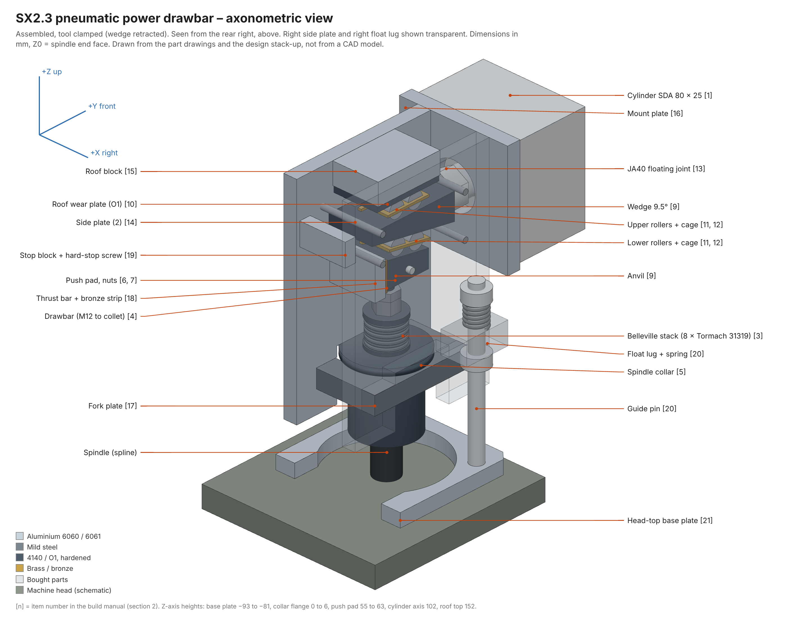

The axonometric view above shows the finished assembly with the tool clamped, seen from the rear right and above, with the right side plate and right float lug transparent. It is drawn from the part drawings and the height stack-up, not from a CAD model. The side view and exploded view below are the original concept drawings.

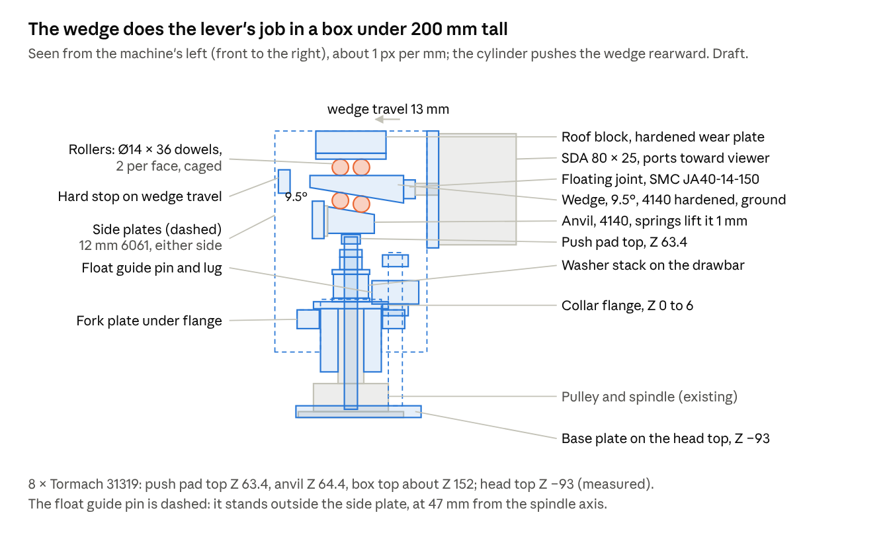

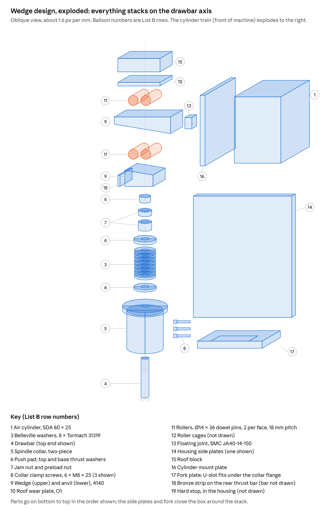

**Parts** (item numbers as in the design doc's List B)

| Item | Part | Qty | Made from | Section |
| --- | --- | --- | --- | --- |
| 1 | SDA 80 × 25 cylinder | 1 | Bought (owned) | 10 |
| 2 | Flat-nose 3/4" TTS R8 collet, M12 × 1.75 | 1 | Bought (received) | 4, 11 |
| 3 | Belleville washers, Tormach 31319 | 8 (+8 spare) | Bought (ordered 14 Nov 2026, awaiting delivery) | 9 |
| 4 | Drawbar | 1 | 4140 Ø16 | 6.1 |
| 5 | Spindle collar, two-piece | 1 | 4140 Ø65 | 6.4 |
| 6 | Push pad; thrust washers (3 and 4 thick) | 1; 2 | 4140 Ø16 offcut; 4140 Ø50 | 6.2, 6.3 |
| 7, 8 | Drawbar nuts (7/16-20); collar screws (M8 × 25, 12.9) | 2; 6 | Bought | 12 |
| 9 | Wedge; anvil | 1; 1 | 4140 Ø50 | 7.1, 7.2 |
| 10 | Roof wear plate | 1 | O1 40 × 5 | 7.3 |
| 11 | Rollers, Ø14 × 36 dowels | 4 (+1) | Bought | 9 |
| 12 | Roller cages; cage cross pins; cage springs | 2; 4; 4 | 2 mm brass; Ø5 silver steel; bought | 8.11, 6.6 |
| 13 | SMC JA40-14-150 floating joint, M14 × 1.5 stud | 1 | Bought | 9 |
| 14 | Side plates | 2 | 12 × 160 bar, 6060 | 8.1 |
| 15 | Roof block | 1 | 6061 20 × 65 × 50 | 8.5 |
| 16 | Cylinder mount plate | 1 | 12 × 160 bar, 6060 | 8.4 |
| 17 | Fork plate | 1 | 16 mm mild steel | 8.2 |
| 18 | Rear thrust bar, bronze strip, lift pins, lift springs | 1, 1, 2, 2 | 6061 10 × 30; bronze 3 × 25; bought | 8.6, 8.7 |
| 19 | Rear stop block and M8 × 30 hard-stop screw | 1 | 6061 10 × 30 | 8.8 |
| 20 | Float guides: pins, lugs, bushes, collars, springs | 2 sets | Ø12 h6 rod; 6061 25 × 20; bought | 6.5, 8.9 |
| 21 | Head-top base plate | 1 | 12 × 160 bar, 6060 | 8.3 |
| 22–31 | Regulator, valve, flow controls, silencers, tube, button, relays, fuse | — | Bought | 10 |
| 32 | Z-axis gas strut | 1 | Bought after weighing the head | 10 |

## 3. Tools, cutters, programs and stock

**CNC tool table** (set these numbers and lengths in the Acorn tool library before running any program; every program calls `T# M6` then `G43 H#`)

| Tool | Description | Used by programs |
| --- | --- | --- |
| T1 | Spot drill, 90°, 6 mm or larger | All hole programs |
| T2 | 6 mm carbide end mill, 2–3 flute, centre-cutting | O1102, O1103, O1501, O2001 |
| T3 | 10 mm carbide end mill, 2–3 flute, centre-cutting, at least 17 mm flute length | O1201, O1301, O1401, O1901, O2101, O2201 |
| T10 | Drill 2.5 (M3 tap drill) | O1601, O1701 |
| T11 | Drill 3.4 (M3 clearance) | O1501, O1703 |
| T12 | Drill 4.2 (M5 tap drill) | O1702, O1802 |
| T13 | Drill 5.0 (M6 tap drill) | O1101, O1201 |
| T14 | Drill 5.1 (cage cross pins) | O1101 |
| T15 | Drill 5.5 (M5 clearance) | O1101 |
| T16 | Drill 5.8 (6 H7 ream size) | O1101, O1301, O1502 |
| T17 | Drill 6.6 (M6 clearance) | O1301, O1401 |
| T18 | Drill 6.8 (M8 tap drill, pilots) | O1301, O1401, O1502, O1801, O1901, O2102 |
| T19 | Drill 7.0 (lug screws) | O1902 |
| T20 | Drill 8.5 (M8 clearance) | O1101 |
| T21 | Drill 12.5 (M14 × 1.5 tap drill) | O2102 |
| T22 | Drill 4.8 (5 H7 ream size) | O2202 |

The O1101 side-plate holes go through a stacked pair, 24 mm, so T13–T20 need at least 30 mm of flute: standard jobbers are fine.

**Feeds and speeds used in the programs** (my starting values for a light bench mill, not sourced; check on scrap and use the override)

| Material | 6 mm end mill | 10 mm end mill | Drills | Spot |
| --- | --- | --- | --- | --- |
| 6060 / 6061 | 5,000 rpm, 400 mm/min, 1.0 mm steps | 4,000 rpm, 500 mm/min, 1.5 mm steps | 60 m/min (5,000 rpm cap), pecks 2 mm | 3,000 rpm |
| 4140 pre-hardened, mild steel, O1 (annealed) | 1,600 rpm, 100 mm/min, 0.5 mm steps | 1,000 rpm, 90 mm/min, 0.8 mm steps | 18 m/min, pecks 1 mm | 1,000 rpm |
| Brass | 4,500 rpm, 300 mm/min, 0.7 mm steps | 3,500 rpm, 350 mm/min | 50 m/min | 3,000 rpm |

**Hand tools for operations the programs don't do**

- Taps: M3, M5, M6, M8, M14 × 1.5 (bottoming), 7/16-20 UNF (bottoming), and an M6 Helicoil (STI) kit with its tap and inserting tool.
- Reamers: 5 H7, 6 H7, 12 H8 (to size the lug bushes after pressing), 16 H7 (lug bores).
- Lathe: single-point threading for M12 × 1.75 and 7/16-20 UNF; parting tool; boring bar for Ø22.
- Measuring: micrometers 0–50, depth gauge, dial indicator, feeler gauges, a 100 mm sine bar with slip gauges (16.505 mm for 9.5°), hardness file or tester.
- Heat treatment: a furnace or kiln that holds 860 °C, quench oil and a metal container, stainless foil, a kitchen-style oven for tempering at 200 °C.

**Stock** (all bought except where marked)

| Stock | For | Status (14 Nov) |
| --- | --- | --- |
| 4140 Ø16 × 1 m | Drawbar, push pad | Bought |
| 4140 Ø50 × 150 | Wedge, anvil, thrust washers | Bought |
| 4140 Ø65, at least 70 long | Collar | Bought (length to check) |
| O1 ground flat 40 × 5 × 500 | Wear plate | Bought |
| W1 silver steel Ø5, 2 m | Cage cross pins | Bought |
| 6060 flat 12 × 160 × 1000 | Side plates, base plate, mount plate | Bought |
| 6061 20 × 65 × 50; 10 × 30 × 100; 25 × 20 × 100 | Roof block; thrust bar and stop block; lugs | Bought |
| Mild steel 16 × 100 × 70 | Fork plate | Bought |
| Ø12 h6 ground rod, at least 300 | Guide pins | **To buy** |
| Bronze strip 3 × 25 × 40 | Thrust bar face | **To buy** |
| Brass sheet 2 mm, about 100 × 50 | Roller cages | **To buy** |

## 4. Measurements and hold points

None of these were measured by 14 Nov, so each is a **hold point**: don't start the operation in the right-hand column until the value is recorded here and on the measurement sheet. Most of the plate and block work doesn't depend on any of them and can start now (section 5).

| # | Measure | How | Record | Holds |
| --- | --- | --- | --- | --- |
| M1 | Spline crest diameter at 3 heights in the top 40 mm, two positions 90° apart; root diameter; file test on a crest | Micrometer over two opposite crests; a fine file on a crest where it doesn't matter (bites = soft, skates = hard) | Crest Ø \_\_\_\_ / \_\_\_\_ / \_\_\_\_ ; root Ø \_\_\_\_ ; file \_\_\_\_ | Finish-boring the collar (6.4, op 8). The bore is 22.0 for 21.9 crests: if the crests read differently, bore to crest + 0.1 before shimming |
| M2 | Collet internal thread depth, L1 − 3 | Depth gauge into the flat-nose collet | L1 = \_\_\_\_ + 3 = \_\_\_\_ | Cutting the drawbar to length (6.1) |
| M3 | Collet tip to spindle end face with a holder clamped, H | Test drawbar (below) holding a TTS holder; measure from the spindle end face down to the collet's top end through the bore, or derive from the test-rod length | H = \_\_\_\_ | Cutting the drawbar to length (6.1) |
| M4 | Flat-nose collet stick-out, clamped | Depth rod from the spindle nose to the collet face, holder clamped at about 20 Nm | \_\_\_\_ mm (limit 1.5) | Grinding the collet nose (only if over 1.5) |
| M5 | Release stroke s\_r | Measurement sheet section 5: loosen in quarter turns (0.44 mm each on M12 × 1.75) until the holder drops and re-inserts freely | s\_r = \_\_\_\_ | Setting the hard stop (11); confirms 8 washers at 5.0 bar (good to about 1.2 mm; 1.6 mm needs 5.5 bar) |
| M6 | Taper break effort | First tap in M5: light / firm / hard | \_\_\_\_ | Information for P, the push-out force |
| M7 | JA40 fitted length on the cylinder rod, retracted | From the cylinder front face to the face of the JA stud nut | \_\_\_\_ (30 or less: no spacers) | Cutting spacer tubes (9) |
| M8 | Under the four base-plate M6 positions | Pilot-drill Ø3 at each position through the 9 mm casting top, or look underneath | Clear / rib at \_\_\_\_ | Drilling and tapping the head (9) |
| M9 | Head weight W | Z coupling undone; luggage scale; average of the just-rising and just-falling readings, housing fitted | W = \_\_\_\_ N | Buying the gas strut |
| M10 | Coast-down from 5,000 rpm (top speed) to stopped | Stopwatch | \_\_\_\_ s | Setting K2T (10) |
| M11 | Acorn spare inputs and outputs; spindle-on signal | Wiring diagram and the Acorn Wizard | IN \_\_ , OUT \_\_ ; signal \_\_\_\_ | Wiring K1 and K2T (10) |
| M12 | 4140 supply condition | Edcon certificate, or a hardness file | \_\_\_\_ HB | Choosing speeds for the 4140 parts |
| M13 | 6060 temper | Label or certificate | T\_\_ | Nothing, unless softer than T5 (tell me) |

**Temporary M12 test drawbar for M3–M6.** The old 7/16-20 drawbar doesn't fit the new collet. Use grade 8.8 M12 × 1.75 threaded rod about 300 long, with a thick washer (outside diameter over 22, bore 13) and a nut bearing on the spindle end face. Tighten it to about 20 Nm dry or 15 Nm oiled to approximate the 8.2 kN design preload (T ≈ 0.2 × 8.2 kN × 12 mm = 19.7 Nm; the 0.2 and 0.15 nut factors are typical values, from memory).

## 5. Build sequence

The order is set by two things: the hardened parts go through one heat treatment batch together, and the drawbar and collar wait for measurements. Everything in stage A can start now.

| Stage | Work | Sections | Waits on |
| --- | --- | --- | --- |
| A1 | Cut all blanks: aluminium bar (side plates, base plate, mount plate), blocks and flats, fork plate, Ø50 bar (washers first, then wedge and anvil), O1 wear plate | 6.3, 7, 8 | — |
| A2 | Square every plate and block blank to its finished outline on the manual mill (faces and edges) | 8 | A1 |
| A3 | Run the plate and block programs: side plates (O1101–O1103), fork (O1201), base plate (O1301), mount plate (O1401), roof block (O1501–O1502), thrust bar and strip (O1701–O1703), stop block (O1801–O1802), lugs (O1901–O1902), cages (O2001); tap and ream by hand | 8 | A2; bronze strip and brass sheet bought |
| A4 | Rough-machine the wedge and anvil, run O2101/O2102 and O2201/O2202, drill and tap the wear plate (O1601) | 7 | A1 |
| A5 | Turn the thrust washers (6.3) and push pad (6.2) | 6 | A1 |
| B | Measurements M1–M5 with the temporary M12 test drawbar | 4 | Test rod |
| C1 | Turn the drawbar (6.1) | 6.1 | M2, M3 |
| C2 | Turn, drill, split and bore the collar (6.4) | 6.4 | M1 |
| C3 | Turn the guide pins (6.5) and cage cross pins (6.6) | 6.5, 6.6 | Ø12 rod bought |
| D | Heat-treat the wedge, anvil, push pad, thrust washers (4140) and the wear plate (O1); check hardness | 7.4 | A4, A5 (and the drawbar guide section if you harden it) |
| E | Grind references, slopes and sides; check the wedge–anvil match; lap the thrust washers; press the lift pins into the anvil | 7.5 | D |
| F | Head preparation and base plate fitting (M8 first) | 9.1 | A3 |
| G | Build the housing in order, fit the collar and drawbar stack, hang the housing, fit the cylinder (M7) | 9.2–9.4 | C, E, F; washers bought |
| H | Pneumatics and electrical (M10, M11) | 10 | G; parts bought |
| I | Commissioning: preload, gaps, hard stop (M5), first release, interlock checks | 11 | H |
| J | Gas strut (M9) | 10 | G |

## 6. Turned parts

Turned parts are made on the lathe, so they have operation tables rather than G-code. Positions are given as Z along the part from a named datum face.

### 6.1 Drawbar (item 4) — hold point M2, M3

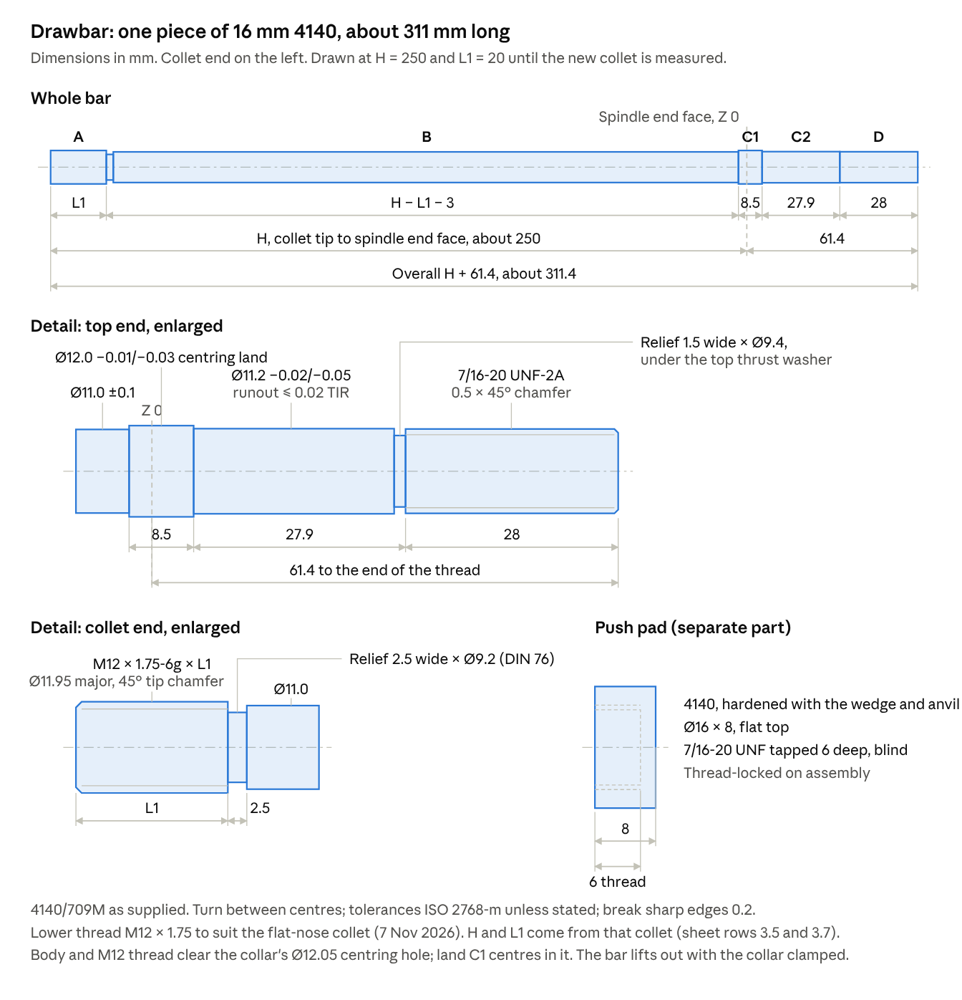

4140 Ø16, turned between centres. Datum Z 0 = the collet-end tip. H (tip to spindle end face) and L1 (lower thread length = collet thread depth + 3) are TBD; the example column uses the drawing's H = 250, L1 = 20.

| Op | Section | Ø | From Z | To Z | Example (mm) | Notes |
| --- | --- | --- | --- | --- | --- | --- |
| 1 | Saw blank | Ø16 | — | — | 320 | H + 61.4 + about 8 for facing and centres |
| 2 | Face to length, centre-drill both ends | — | 0 | H + 61.4 | 0 → 311.4 |  |
| 3 | C1 centring land (largest diameter: turn first) | 12.0 −0.01/−0.03 | H − 3 | H + 5.5 | 247 → 255.5 | Close fit in the collar's Ø12.05 hole |
| 4 | C2 guide | 11.2 −0.02/−0.05 | H + 5.5 | H + 31.9 | 255.5 → 281.9 | Fine finish; ≤0.02 TIR to the centres. Nitride or harden if practical |
| 5 | Top relief | 9.4 × 1.5 wide | H + 31.9 | H + 33.4 | 281.9 → 283.4 | Under the top thrust washer |
| 6 | D top thread | 7/16-20 UNF-2A | H + 33.4 | H + 61.4 | 283.4 → 311.4 | Single-point; 0.5 × 45° chamfer; check with the preload nut |
| 7 | B body | 11.0 ±0.1 | L1 + 2.5 | H − 3 | 22.5 → 247 | Small undercut at each step |
| 8 | Lower relief | 9.2 × 2.5 wide (DIN 76) | L1 | L1 + 2.5 | 20 → 22.5 |  |
| 9 | A lower thread | M12 × 1.75-6g, major 11.95 | 0 | L1 | 0 → 20 | Single-point; 45° tip chamfer; check in the collet. Major kept at 11.95 so it passes the collar's 12.05 hole |

Check before taking it off the centres: the guide runs true within 0.02, the M12 runs into the collet by hand, the 7/16-20 nut runs freely. Overall length tolerance ±0.2.

### 6.2 Push pad (item 6)

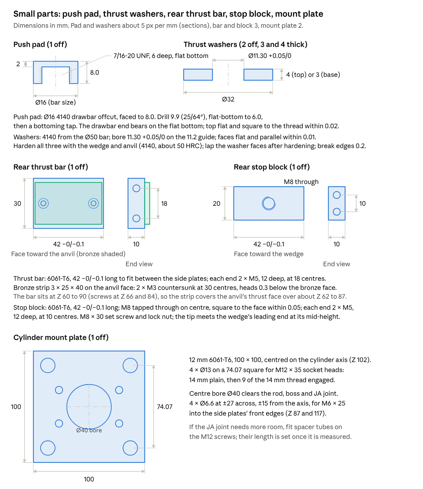

4140, Ø16 drawbar offcut. Datum Z 0 = top (pad) face.

| Op | Operation | Size | Notes |
| --- | --- | --- | --- |
| 1 | Chuck the offcut, face the top | — | This is the pressing face |
| 2 | Drill from the other end after parting, or from this end before parting | 9.9 (25/64") to 6.0 deep, flat-bottomed with a 10 mm end mill | Leaves 2.0 under the thread |
| 3 | Bottoming tap | 7/16-20 UNF, 6 full threads deep | Check on the drawbar's top thread |
| 4 | Part off at 8.3, screw onto a 7/16-20 stud held in the chuck, face to 8.0 | 8.0 overall | Top face square to the thread within 0.02 |
| 5 | Harden with the batch (7.4) | About 50 HRC |  |

### 6.3 Thrust washers (item 6, two off)

Turned off the end of the Ø50 4140 bar before the wedge and anvil are sawn (stage A1). Datum = bar end.

| Op | Operation | Size | Notes |
| --- | --- | --- | --- |
| 1 | Chuck the Ø50 bar, face | — |  |
| 2 | Turn the OD for 14 mm | Ø32 |  |
| 3 | Drill and bore | Ø11.30 +0.05/0 | Slides on the 11.2 guide |
| 4 | Part off at 4.3; face; part off at 3.3 | — | Thick one is the top washer |
| 5 | Face the parted sides | 4.3 → 4.0 + 0.3; 3.3 → 3.0 + 0.3 | Leave for lapping |
| 6 | Harden with the batch, then lap | 4.0 and 3.0 | Flat and parallel within 0.01; figure-of-eight on a plate |

### 6.4 Spindle collar (item 5) — hold point M1 before the final bore

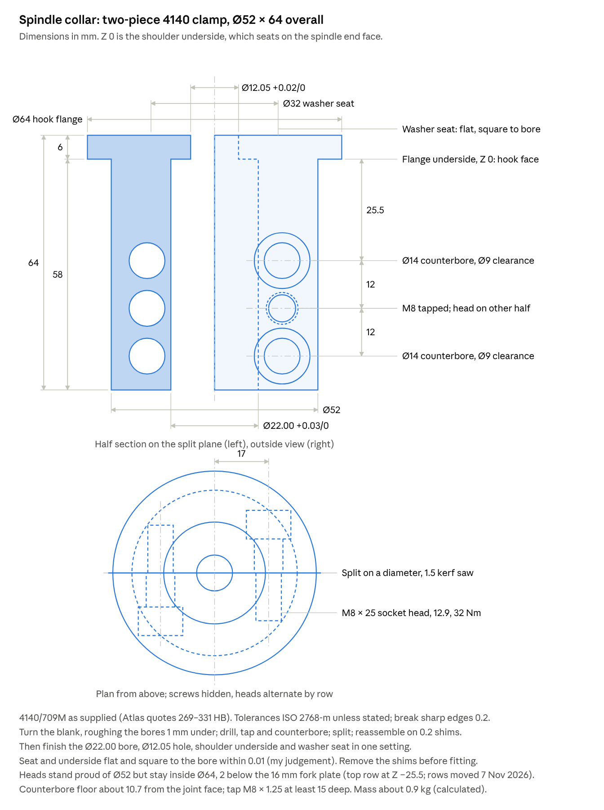

4140 Ø65, blank 70 long. Datum Z 0 = shoulder underside (also the flange underside), which seats on the spindle end face; the flange top and washer seat are at Z +6, the skirt end at Z −58.

| Op | Operation | Size | Notes |
| --- | --- | --- | --- |
| 1 | Saw 70, face both ends to 64.5 | — | 0.5 left for the final facing |
| 2 | Turn the flange | Ø64 × 6 at the top end | Only 0.5 a side to clean up |
| 3 | Turn the skirt | Ø52 for 58.5 |  |
| 4 | Rough bores | Ø21.0 through the skirt; Ø11.0 through the shoulder | Both 1 mm under |
| 5 | Drill, counterbore and tap the six clamp holes on the mill | Table below | Before splitting |
| 6 | Split on a diameter (the Y = 0 plane in the table) | Slitting saw, about 1.5 kerf | Deburr |
| 7 | Reassemble with 0.2 shims in both joints; torque the six M8 × 25 12.9 to 32 Nm | — | Mark the halves |
| 8 | **One setting:** finish-bore the spline bore; bore the centring hole; face the shoulder underside and the washer seat | Ø22.00 +0.03/0 (or M1 crest + 0.1); Ø12.05 +0.02/0; overall 64.0 | Seat and underside flat and square to the bore within 0.01 |
| 9 | Remove the shims for fitting | — | Each joint then closes 0.2 onto the spline |

**Clamp hole offsets (op 5).** Set the blank on the mill with its axis horizontal along machine X and the future split plane horizontal. Work zero: X 0 at the shoulder underside (Z 0 of the collar), Y 0 on the collar axis, Z 0 on the collar axis (the top of the Ø52 is at Z +26). Holes are vertical, perpendicular to the split plane.

| Hole | X (along the axis) | Y | First setup (half A up) | After turning over 180° about the axis (half B up) |
| --- | --- | --- | --- | --- |
| R1+ | −25.5 | +17 | Drill 6.8 through; Ø9 to Z 0; counterbore Ø14 to Z +10.7 | Tap M8 from the joint face after splitting, ≥15 deep |
| R2+ | −37.5 | +17 | Drill 6.8 through | (now at Y −17) Ø9 to Z 0; counterbore Ø14 to Z +10.7 |
| R3+ | −49.5 | +17 | Drill 6.8 through; Ø9 to Z 0; counterbore Ø14 to Z +10.7 | Tap M8 from the joint face |
| R1− | −25.5 | −17 | Drill 6.8 through | (now at Y +17) Ø9 to Z 0; counterbore Ø14 to Z +10.7 |
| R2− | −37.5 | −17 | Drill 6.8 through; Ø9 to Z 0; counterbore Ø14 to Z +10.7 | Tap M8 from the joint face |
| R3− | −49.5 | −17 | Drill 6.8 through | (now at Y +17) Ø9 to Z 0; counterbore Ø14 to Z +10.7 |

Every hole is 6.8 through first (peck; about 39 mm of wall). Holes whose head is on the other half are tapped M8 from that half's joint face after splitting. The rows at 25.5, 37.5 and 49.5 below the shoulder keep the top heads 2 mm under the 16 mm fork plate (changed 7 Nov 2026).

### 6.5 Guide pins (item 20, two off)

Ø12 h6 ground rod. Datum = the top (plain) end.

| Op | Operation | Size | Notes |
| --- | --- | --- | --- |
| 1 | Cut 142, face to 140 | 140 overall |  |
| 2 | Turn the spigot | Ø8.0 × 11 long, small undercut at the shoulder | Face the shoulder in the same setting: its squareness keeps the pin vertical |
| 3 | Die-cut the spigot | M8 × 1.25 | Try it in the base plate's C hole |
| 4 | Chamfer the top | 0.5 × 45° |  |

If the rod is induction-hardened linear shaft, use carbide for op 2: the case is hard.

### 6.6 Cage cross pins (item 12, four off)

Ø5 W1 silver steel, about 75 long; e-clip grooves just outside each side plate (outer faces at ±33 from the centreline, so grooves at about ±33.5). Cut one, check it on the assembled plates, then make the other three. Groove size from the DIN 6799 clip packet for a 5 mm shaft. Not hardened.

### 6.7 Spacer tubes — hold point M7

Only if the JA joint measures over 30 mm (M7): four tubes, bore 13, about 18 outside, length = M7 − 30, faced square. The M12 cylinder screws become 35 + that length.

## 7. Hardened parts

The wedge, anvil, push pad and thrust washers are 4140 HT, bought pre-hardened (about 269–331 HB, voestalpine datasheet). The wear plate is O1, bought annealed. All of them are machined first, with the holes and threads, then hardened at home (7.4) and ground (7.5). Every face that is ground carries **0.3 mm** of stock when it is milled. The offset tables give both the finished size and the as-milled size; the G-code uses the as-milled numbers.

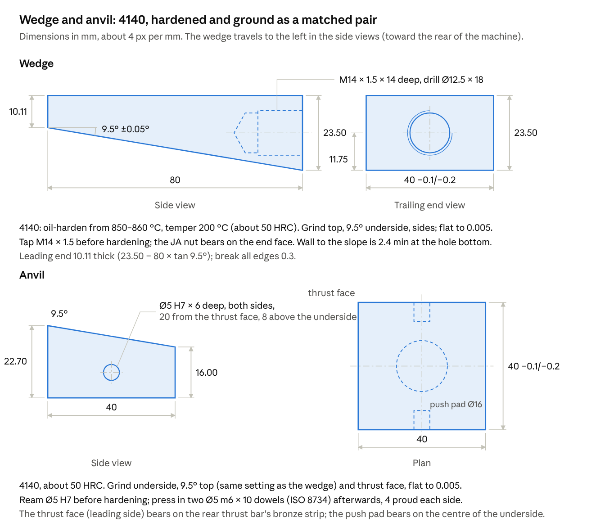

### 7.1 Wedge (item 9)

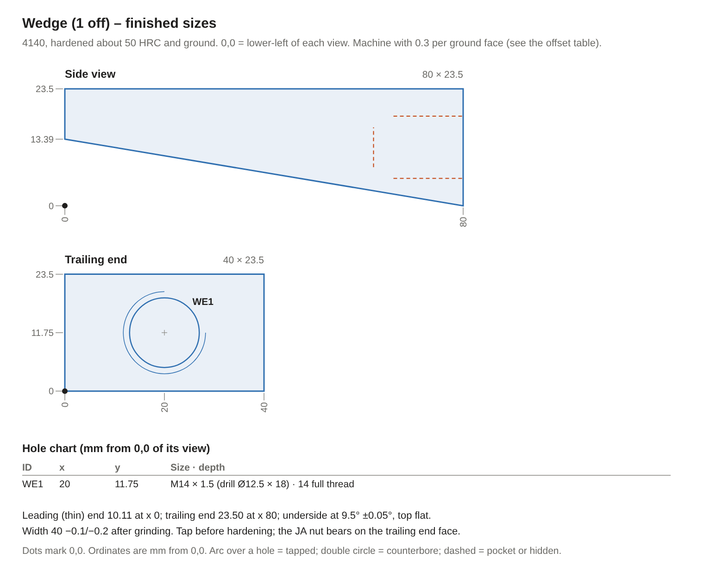

Stock: Ø50 4140 HT, saw 84 long. Square it on the manual mill to **80.0 × 40.6 × 24.1**. The ends are not ground, so mill them to 80.0 finished.

| Feature | Finished | As milled (before HT) | Datum | Program |
| --- | --- | --- | --- | --- |
| Length | 80.0 ±0.1 | 80.0 | — | Manual mill |
| Width | 40 −0.1/−0.2 | 40.6 | — | Manual mill |
| Thickness at the trailing end (x 80) | 23.50 | 24.10 | Top face | Manual mill |
| Thickness at the leading end (x 0) | 10.11 | 10.71 | Top face | O2101 |
| Underside slope | 9.5° ±0.05° | 9.5° | Top face | O2101 |
| WE1, M14 × 1.5, in the trailing end face | Centre (20, 11.75) | Centre (20.3, 12.05) | End-face lower-left, Y0 on the slope side | O2102 |

**O2101 setup.** Saw off the bulk of the slope first, 1.5 above the line. Clamp top face down on parallels, 80 along X, thin end at X0, 40.6 along Y. Z0 = top of the blank as clamped (24.1 above the parallels). Tool T3, 10 mm carbide. Roughing passes step 0.8 down and 4 across, then a finishing pass runs at 1 mm stepover. Every pass is capped at the finished slope under the whole cutter footprint, so the flat end mill cannot gouge. The finish leaves steps of about 0.17 (1 × tan 9.5°), inside the 0.3 grinding allowance.

**O2102 setup.** Stand the wedge on its trailing end in the vise. X runs along the 40.6 width; the as-milled top face is toward +Y; Y0 is on the slope side. Spot, drill 6.8, then drill 12.5. Every drill depth is to the tip: 18 deep gives about 14.2 of full diameter. Tap M14 × 1.5 with a plug tap, then a bottoming tap, for about 13 full threads (more than 0.9 d engagement in 4140). Tap before hardening.

Hand operations: break all edges 0.3 except the leading tip. Stamp the part number on the trailing end, away from the hole.

### 7.2 Anvil (item 9)

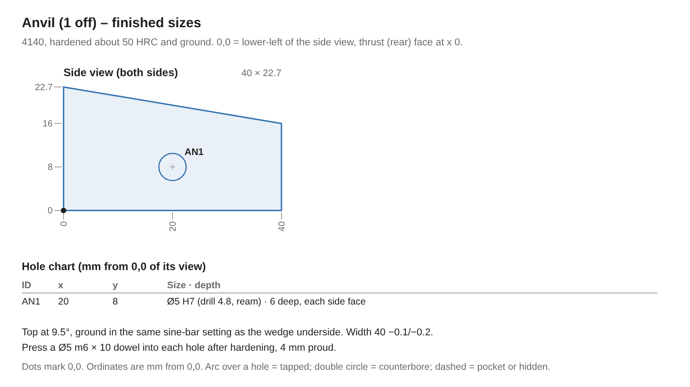

Stock: Ø50 4140 HT, saw 44 long. Square it to **40.0 × 40.6 × 23.3**. The thrust face and the opposite end are not ground, so mill them to 40.0 finished.

| Feature | Finished | As milled (before HT) | Datum | Program |
| --- | --- | --- | --- | --- |
| Length (thrust face to front) | 40.0 ±0.1 | 40.0 | — | Manual mill |
| Width | 40 −0.1/−0.2 | 40.6 | — | Manual mill |
| Height at the thrust face (x 0) | 22.70 | 23.30 | Underside | Manual mill |
| Height at the front (x 40) | 16.00 | 16.60 | Underside | O2201 |
| Top slope | 9.5° ±0.05° | 9.5° | Underside | O2201 |
| AN1 Ø5 H7 × 6, both side faces | (20, 8) | (20.0, 8.3) | Side-face lower-left: thrust face X0, underside Y0 | O2202 |

**O2201 setup.** Underside down on parallels, 40 along X, thrust (tall) end at X0. Z0 = top of the blank (23.3 above the parallels). T3. Same gouge-safe surfacing as O2101.

**O2202 setup.** Anvil on its side in the vise, a 40 × 23.3 side face up, thrust face at X0, as-milled underside at Y0. Run it for each side. The 4.8 drill goes to a tip depth of 7.5 (about 6.1 at full diameter). Hand-ream Ø5 H7 to 6.5 deep before hardening. *Corrected 14 Nov: the first issue of O2202 put the hole at X 20.3. The length is not ground, so X is 20.0.*

After hardening, try a Ø5 m6 × 10 dowel in each hole. If hardening has closed the hole, polish it with a split lap. Press the dowel in, or fix it with retaining compound (Loctite 638 or similar), 4 mm proud. These are the lift pins that ride in the side-plate pockets (G1), so they only need to stay put.

### 7.3 Roof wear plate (item 10)

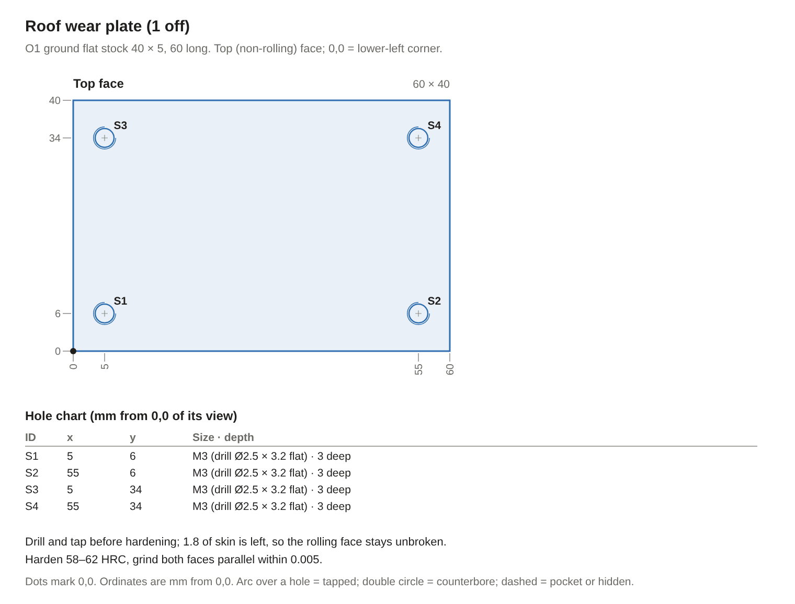

Stock: O1 ground flat stock 40 × 5, cut 61 long and mill the ends to 60.0. 0,0 = lower-left of the top (non-rolling) face.

| Hole | X | Y | Size | Depth | Program |
| --- | --- | --- | --- | --- | --- |
| S1 | 5 | 6 | M3 (drill Ø2.5) | 3.2 to the tip | O1601 |
| S2 | 55 | 6 | M3 (drill Ø2.5) | 3.2 to the tip | O1601 |
| S3 | 5 | 34 | M3 (drill Ø2.5) | 3.2 to the tip | O1601 |
| S4 | 55 | 34 | M3 (drill Ø2.5) | 3.2 to the tip | O1601 |

A 3.2 depth leaves 1.8 of skin under the rolling face. The ordered M3 × 18 screws go 2.5 into the plate (18 − 15.5 through the roof block under the 3.5 counterbore). With a pointed 2.5 drill, the hole is only full diameter to about 2.4, so the screw tip would reach the drill cone. **Flat-bottom the holes:** after O1601, re-cut each one to 3.2 with a spare 2.5 drill ground flat, then use a bottoming tap. That gives about 5 threads (pitch 0.5). That is enough, because the screws only locate the plate: the clamping load goes into the roof block. The fallback is to take 0.5 off each screw's end.

### 7.4 Heat treatment (at home)

You need a furnace or kiln that will hold 860 ±10 °C with a thermocouple, a metal tank of quench oil with a lid, and a domestic oven with a separate oven thermometer for tempering. Wrap each part in stainless heat-treat foil to limit scale and decarburisation. The 0.3 grind allowance covers what remains.

| Part | Steel | Preheat | Harden (soak) | Quench | Temper | Expected |
| --- | --- | --- | --- | --- | --- | --- |
| Wedge, anvil | 4140 | None: heat slowly | 850–860 °C, 30 min after the part is at temperature | Oil, agitate; out at about 60 °C | 200 °C × 2 h, twice; air cool between | About 50–54 HRC |
| Push pad, thrust washers | 4140 | — | 850–860 °C, 15 min | Oil | 200 °C × 2 h, twice | About 50–54 HRC |
| Wear plate | O1 | 650–700 °C, equalise (heat no faster than about 220 °C/h) | 800–815 °C, 20 min (30 min per 25 mm, 5 mm thick) | Oil, warm oil best; out at 50–65 °C | Straight away: 180–200 °C × 2 h, twice | About 58–62 HRC |

Rules:

- Take each part out of its foil and get it into the oil within about 3 s. Quench thin edges first, moving it up and down, not side to side.
- Quench the wear plate vertically, along its 60 length, to keep it flat. Temper it clamped between two flat steel plates.
- **Do not temper 4140 between 230 and 370 °C.** The Atlas datasheet warns of blue brittleness in that range. Stay at 200 °C.
- Check hardness with a file: a new file should skate on a hardened face. If you have a tester, test on the end of the wedge, which is not ground.
- A gas or charcoal forge works if you use a magnet check: heat until the part is no longer magnetic, then about one more shade. Expect less consistent results.

Sources: the 4140 figures (850–860 °C, heat slowly, oil quench, temper 175–230 °C, avoid 230–370 °C) come from the Atlas 4140 datasheet cited in the design doc, and agree with the voestalpine Australia 4140 datasheet (830–860 °C, oil). The O1 preheat, hardening, soak, quench and temper come from the Hudson Tool Steel O1 data and the Industeel 1.2510 datasheet (double temper). The expected hardness figures are my reading of typical tempering curves, not datasheet values, so check them with a file or tester. The 3 s transfer, the 60 °C out-of-oil temperature for 4140, and canola or other vegetable quench oil are common practice, not datasheet guidance. If you would rather not quench at home, a commercial heat-treater can do it: ask for the 4140 parts at 48 HRC minimum, tempered about 200 °C, and the O1 plate at 58–62 HRC with a double temper.

### 7.5 Grinding (surface grinder)

White or pink aluminium-oxide wheel, dressed before each part. Take 0.01 a pass roughing and 0.005 finishing, with flood coolant. The aim is to remove the 0.3 evenly from each face, so take some off each face before finishing any of them.

Set the 9.5° on a sine bar or sine plate: **100 mm bar = 16.505 mm gauge-block stack** (100 × sin 9.5° = 16.5048). For a 5 in bar, 0.8252 in. Use a 9.5° ±0.05° tolerance: on a 100 mm bar that is ±0.087 on the stack, so blocks to 0.01 are plenty.

Order:

1. Wedge top: flat, clean-up only. Anvil underside: flat, clean-up only.
2. Sides of both parts, on an angle plate, to 40 −0.1/−0.2. Grind the two parts together in one setting so they are the same width.
3. **One sine setting for both slopes:** set the stack, then grind the wedge underside (top face down) and the anvil top (underside down) without changing the stack. If the angle is a little off, both parts are off by the same amount and still match.
4. Check the thickness 10 mm in from each end, where a micrometer anvil sits fully on the part:

| Part | Check at | Finished size |
| --- | --- | --- |
| Wedge | 10 from the leading end | 11.78 |
| Wedge | 10 from the trailing end | 21.82 |
| Anvil | 5 from the thrust face | 21.86 |
| Anvil | 5 from the front | 16.84 |

5. Match check, the way the parts carry load: on a surface plate, stack the anvil, two of the matched Ø14 rollers across its slope, then the wedge. The wedge top must be parallel to the plate within 0.01 along and across. If it is not, regrind the anvil slope. The wedge and anvil never touch each other directly: the rollers run between them.
6. Wear plate: grind both faces parallel within 0.005, clean-up only.
7. Thrust washers: lap them (6.3). Push pad: light grind of the pressing face, or lap it.

Demagnetise every part after it comes off the chuck.

## 8. Plate and block parts

Every part here has its drawing, an offset table and its programs. Offsets are from 0,0 at the lower-left corner of each view, as drawn. That is also G54 X0 Y0 for the programs, unless the setup line says otherwise. Edge-find the corner (or pick up the two edges with the DRO), and touch Z0 off the face named in the setup. Prove every program on air 10 mm above Z0 first, as section 1 says.

Mark each blank's datum corner with a felt pen before the first setup and keep it lower-left. For pairs, stamp L and R on the inner faces.

### 8.1 Side plates (item 14, two off) — 6060, 12 mm

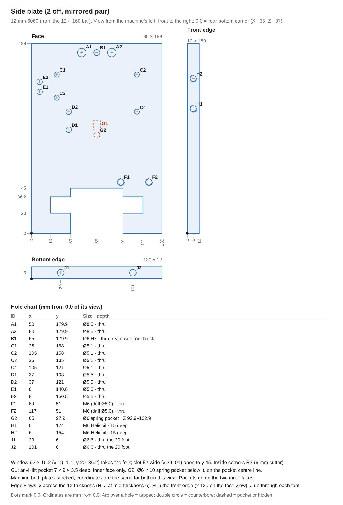

Stock: two blanks 130 × 189 from the 12 × 160 bar (189 along the bar), per the cutting schedule. Square all four edges of both on the manual mill, clamped together, so they are identical: 130.0 ±0.05 × 189.0 ±0.05.

*Face* (130 × 189)

| Hole | X | Y | Size | Depth | Program |
| --- | --- | --- | --- | --- | --- |
| A1 | 50 | 179.9 | Ø8.5 | thru | O1101 |
| A2 | 80 | 179.9 | Ø8.5 | thru | O1101 |
| B1 | 65 | 179.9 | Ø6 H7 | thru, ream with roof block | O1101 (drill 5.8), ream on assembly |
| C1 | 25 | 158 | Ø5.1 | thru | O1101 |
| C2 | 105 | 158 | Ø5.1 | thru | O1101 |
| C3 | 25 | 135 | Ø5.1 | thru | O1101 |
| C4 | 105 | 121 | Ø5.1 | thru | O1101 |
| D1 | 37 | 103 | Ø5.5 | thru | O1101 |
| D2 | 37 | 121 | Ø5.5 | thru | O1101 |
| E1 | 8 | 140.8 | Ø5.5 | thru | O1101 |
| E2 | 8 | 150.8 | Ø5.5 | thru | O1101 |
| F1 | 89 | 51 | M6 (drill Ø5.0) | thru | O1101 |
| F2 | 117 | 51 | M6 (drill Ø5.0) | thru | O1101 |
| G1 | 61.5–68.5 | 102.9–111.9 | Pocket 7 × 9 | 3.5 deep, inner face | O1103 |
| G2 | 65 | 97.9 | Spring slot 6 wide, Y 92.9–102.9 | 3.5 deep, inner face | O1103 |

*Front edge* (12 × 189)

| Hole | X | Y | Size | Depth | Program |
| --- | --- | --- | --- | --- | --- |
| H1 | 6 | 124 | M6 Helicoil | 15 deep | Manual mill (DRO), plate on edge |
| H2 | 6 | 154 | M6 Helicoil | 15 deep | Manual mill (DRO), plate on edge |

*Bottom edge* (130 × 12)

| Hole | X | Y | Size | Depth | Program |
| --- | --- | --- | --- | --- | --- |
| J1 | 29 | 6 | Ø6.6 | thru the 20 foot | Manual mill (DRO), plate on edge |
| J2 | 101 | 6 | Ø6.6 | thru the 20 foot | Manual mill (DRO), plate on edge |

Order of work:

1. **O1101** — side plate holes, stacked pair. Setup: Both blanks finished to 130 x 189, screwed back to back through the window area, clamped flat on a sacrificial plate; outer face of the LEFT plate up, front edge to +X. Z0 = top face of the stack. Tools T1, T20, T16, T14, T15, T13. Holes A–F go through both plates at once, so they line up. Tap F1 and F2 M6 in each plate afterwards.
2. Separate the plates. Saw out the window and the notch 2 mm inside the lines.
3. **O1102** — side plate window and notch. Setup: One plate at a time on a sacrificial plate, outer face up, front edge to +X; rough out the notch and window with a saw first, 2 mm inside the lines. Z0 = top face of the plate. Tools T2. Run it once for each plate. The path leaves R3 inside corners, from the 6 mm cutter.
4. **O1103** — side plate lift and spring pockets. Setup: Plate inner face up, front edge to +X for the LEFT plate and to −X for the RIGHT plate; X0 Y0 at the lower-left corner as clamped. The pocket is on the centreline (X 65), so one program serves both. Z0 = inner face. Tools T2. It cuts G1 and then G2, the spring slot below it.
5. On the manual mill with each plate standing on edge in the vise, using DRO offsets from the same 0,0 corner:
   - H1, H2: front edge (the X 130 face), X 6 across the thickness, Y 124 and 154. Drill the Helicoil size (6.3 for M6 × 1; check the insert packet), 18 deep. Countersink 90° to Ø7, tap with the Helicoil STI tap 15 deep, and fit 1.5D inserts.
   - J1, J2: bottom edge of each foot, X 29 and 101, mid-thickness. Drill Ø6.6 through the 20 foot. Spot first and peck: it is a 20 deep hole in a 12 wide edge.
6. B1 is drilled 5.8 in O1101. Ream it Ø6 H7 later, through the side plates and roof block together (9.2 step j).

Notes from the drawing:

- Window 92 × 16.2 (x 19–111, y 20–36.2) takes the fork; slot 52 wide (x 39–91) open to y 45. Inside corners R3 (6 mm cutter).
- G1: anvil lift pocket 7 × 9 × 3.5 deep, inner face only. G2: spring pocket below it, on the pocket centre line.
- Machine both plates stacked; coordinates are the same for both in this view. Pockets go on the two inner faces.
- Edge views: x across the 12 thickness (H, J at mid-thickness 6). H in the front edge (x 130 on the face view), J up through each foot.

### 8.2 Fork plate (item 17) — 16 mm mild steel

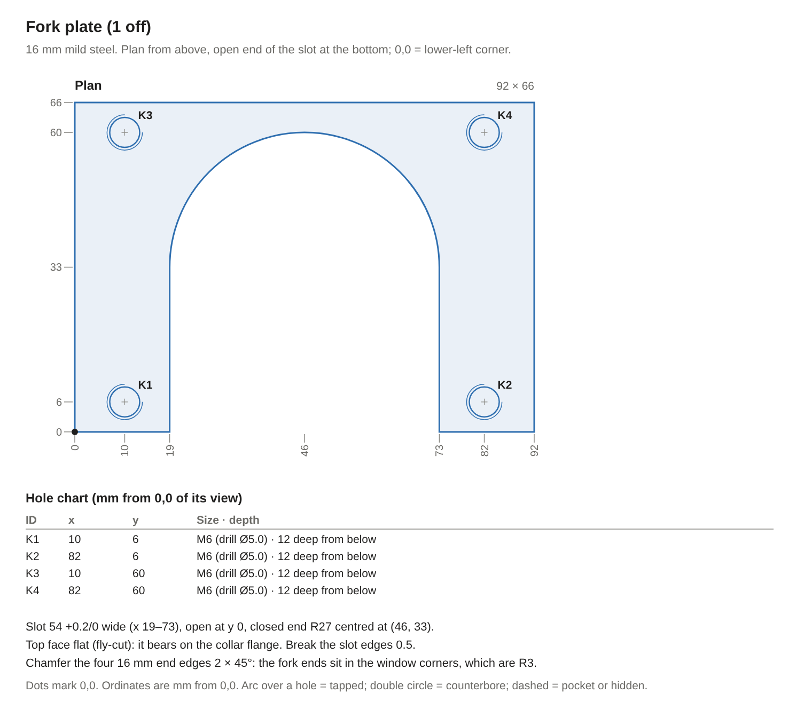

Stock: 16 mm plate, saw 95 × 69, then mill all edges and both faces to 92 × 66 × 16. Fly-cut the top face last: it bears on the collar flange.

*Plan* (92 × 66)

| Hole | X | Y | Size | Depth | Program |
| --- | --- | --- | --- | --- | --- |
| K1 | 10 | 6 | M6 (drill Ø5.0) | 12 deep from below | O1201 |
| K2 | 82 | 6 | M6 (drill Ø5.0) | 12 deep from below | O1201 |
| K3 | 10 | 60 | M6 (drill Ø5.0) | 12 deep from below | O1201 |
| K4 | 82 | 60 | M6 (drill Ø5.0) | 12 deep from below | O1201 |
| Slot | 19–73 | 0–33, R27 end at (46, 33) | 54 +0.2/0 wide | Through | O1201 |

**O1201** — fork plate. Setup: Blank 92 x 66 x 16 (edges and faces already milled), bottom face up for the holes, then top face up for the slot; slot open end toward −Y; rough the slot with a saw first. Z0 = face as clamped. Tools T1, T13, T3.

- First side: bottom face up. Spot and drill the K holes Ø5.0 × 15 (tip depth), then tap M6, 12 full thread. Tap by hand or with a tapping head.
- The program stops at M0 with the spindle and coolant off (M5 M9). Turn the plate over, top face up, slot open end toward −Y, and re-pick X0 Y0 at the same corner as seen from above. Saw out the slot 3 mm inside the line first.
- The slot pass with T3 cuts to depth 16.5, through, on a sacrificial plate. Check the width: 54 +0.2/0.

Hand operations: chamfer the four 16 mm end edges **2 × 45°** (new, 7 Nov: the window corners are R3), and break the slot edges 0.5.

Notes from the drawing:

- Slot 54 +0.2/0 wide (x 19–73), open at y 0, closed end R27 centred at (46, 33).
- Top face flat (fly-cut): it bears on the collar flange. Break the slot edges 0.5.
- Chamfer the four 16 mm end edges 2 × 45°: the fork ends sit in the window corners, which are R3.

### 8.3 Head-top base plate (item 21) — 6060, 12 mm

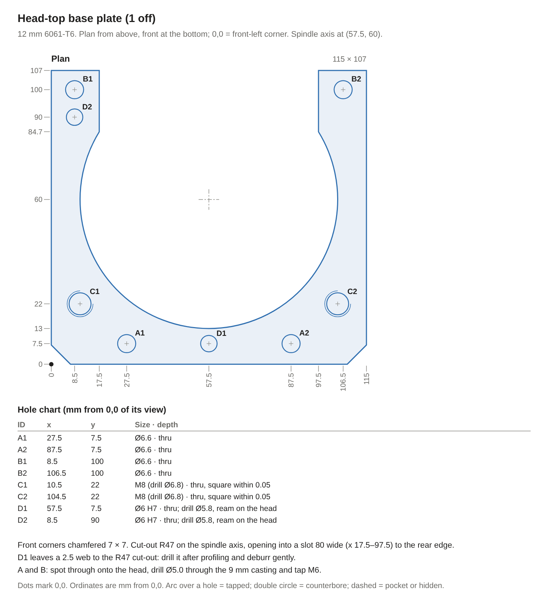

Stock: 12 × 160 bar, saw 110 long, then mill to 115 × 107 (115 across the bar width).

*Plan* (115 × 107)

| Hole | X | Y | Size | Depth | Program |
| --- | --- | --- | --- | --- | --- |
| A1 | 27.5 | 7.5 | Ø6.6 | thru | O1301 |
| A2 | 87.5 | 7.5 | Ø6.6 | thru | O1301 |
| B1 | 8.5 | 100 | Ø6.6 | thru | O1301 |
| B2 | 106.5 | 100 | Ø6.6 | thru | O1301 |
| C1 | 10.5 | 22 | M8 (drill Ø6.8) | thru, square within 0.05 | O1301 |
| C2 | 104.5 | 22 | M8 (drill Ø6.8) | thru, square within 0.05 | O1301 |
| D1 | 57.5 | 7.5 | Ø6 H7 | thru; drill Ø5.8, ream on the head | O1301 (drill 5.8), ream on the head |
| D2 | 8.5 | 90 | Ø6 H7 | thru; drill Ø5.8, ream on the head | O1301 (drill 5.8), ream on the head |
| Cut-out | Centre (57.5, 60) | — | R47, slot 80 wide (x 17.5–97.5) to the rear edge | Through | O1301 |
| Chamfers | Front corners | — | 7 × 7 | Through | O1301 |

**O1301** — head-top base plate. Setup: Blank finished to 115 x 107 x 12, front edge toward −Y, on a sacrificial plate; saw out the R47 cut-out and slot to 3 mm inside the line first. Z0 = top face. Tools T1, T17, T18, T16, T3. The R47 path starts at (22.5, 113), with the tool centre 6 beyond the rear edge so it comes in cleanly. The same tool cuts both 7 × 7 front chamfers.

Hand operations:

- C1 and C2 take the guide-pin spigots. Tap M8 square within 0.05, using the mill spindle as a tap guide.
- D1 and D2 (dowels) are drilled 5.8. Ream them Ø6 H7 through the plate into the head during assembly (9.1), so they line up with the head.
- D1 leaves a 2.5 web to the cut-out. Deburr it gently.

Notes from the drawing:

- Front corners chamfered 7 × 7. Cut-out R47 on the spindle axis, opening into a slot 80 wide (x 17.5–97.5) to the rear edge.
- D1 leaves a 2.5 web to the R47 cut-out: drill it after profiling and deburr gently.
- A and B: spot through onto the head, drill Ø5.0 through the 9 mm casting and tap M6.

### 8.4 Cylinder mount plate (item 16) — 6060, 12 mm

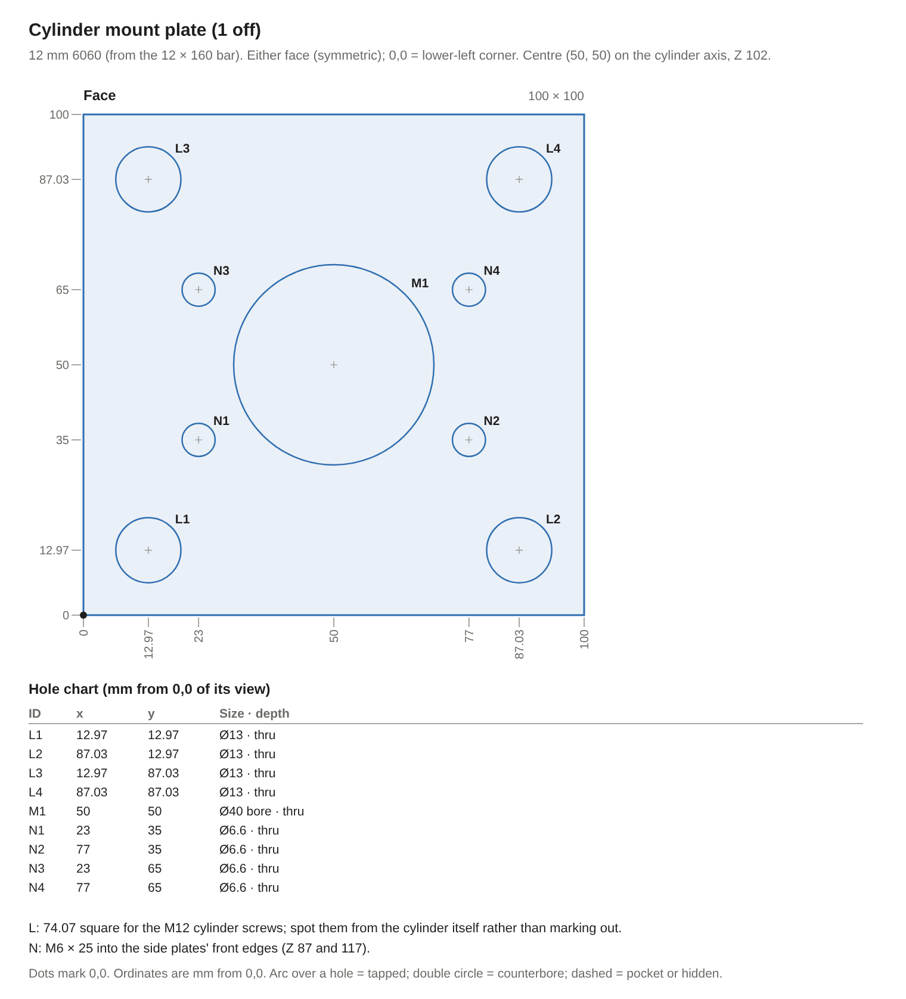

Stock: 12 × 160 bar, saw 103 long, mill to 100 × 100.

*Face* (100 × 100)

| Hole | X | Y | Size | Depth | Program |
| --- | --- | --- | --- | --- | --- |
| L1 | 12.97 | 12.97 | Ø13 | thru | O1401 (better: spot from the cylinder) |
| L2 | 87.03 | 12.97 | Ø13 | thru | O1401 (better: spot from the cylinder) |
| L3 | 12.97 | 87.03 | Ø13 | thru | O1401 (better: spot from the cylinder) |
| L4 | 87.03 | 87.03 | Ø13 | thru | O1401 (better: spot from the cylinder) |
| M1 | 50 | 50 | Ø40 bore | thru | O1401 |
| N1 | 23 | 35 | Ø6.6 | thru | O1401 |
| N2 | 77 | 35 | Ø6.6 | thru | O1401 |
| N3 | 23 | 65 | Ø6.6 | thru | O1401 |
| N4 | 77 | 65 | Ø6.6 | thru | O1401 |

**O1401** — cylinder mount plate. Setup: Blank finished to 100 x 100 x 12 on a sacrificial plate. Z0 = top face. Tools T1, T17, T18, T3. The program cuts the M1 Ø40 bore and the L Ø13 holes by helical milling with T3, after a 6.8 pilot. The L section can be skipped (see below).

Better way to do L: clamp the cylinder's end cap on the plate, centred on M1 with a 40 mm plug or by eye on the spigot. Transfer-punch the four L holes through the cylinder's own screw positions, then drill them on the manual mill. That way the holes match the cylinder in hand, whatever its catalogue square says.

Notes from the drawing:

- L: 74.07 square for the M12 cylinder screws; spot them from the cylinder itself rather than marking out.
- N: M6 × 25 into the side plates' front edges (Z 87 and 117).

### 8.5 Roof block (item 15) — 6061-T6, from the 20 × 65 × 50 roof stock

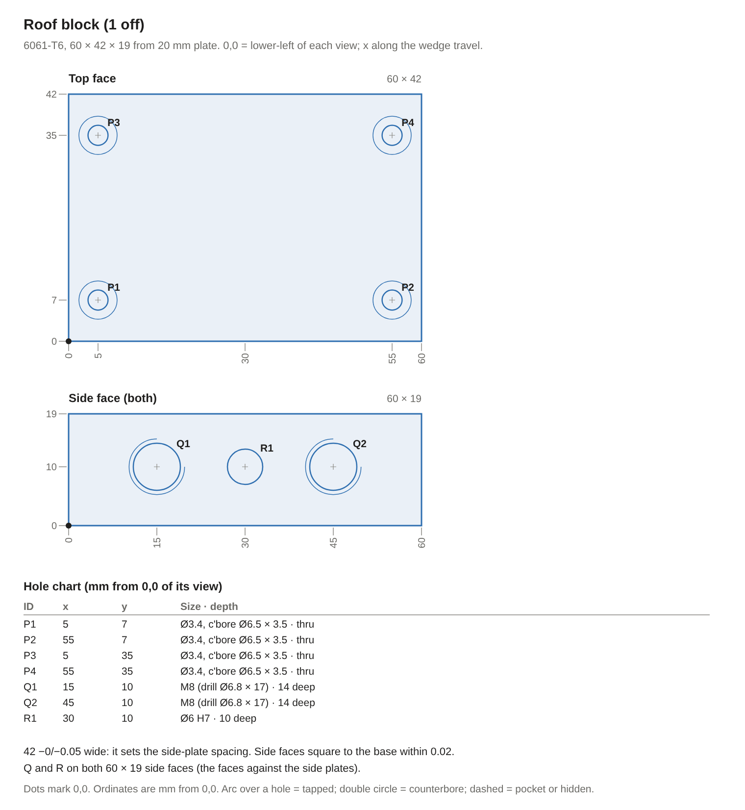

Stock: mill to 60 × 42 × 19. Hold 42 −0/−0.05, because it sets the side-plate spacing, and keep the side faces square to the base within 0.02. Fly-cut the bottom (wear-plate) face last.

*Top face* (60 × 42)

| Hole | X | Y | Size | Depth | Program |
| --- | --- | --- | --- | --- | --- |
| P1 | 5 | 7 | Ø3.4, c'bore Ø6.5 × 3.5 | thru | O1501 |
| P2 | 55 | 7 | Ø3.4, c'bore Ø6.5 × 3.5 | thru | O1501 |
| P3 | 5 | 35 | Ø3.4, c'bore Ø6.5 × 3.5 | thru | O1501 |
| P4 | 55 | 35 | Ø3.4, c'bore Ø6.5 × 3.5 | thru | O1501 |

*Side face (both)* (60 × 19)

| Hole | X | Y | Size | Depth | Program |
| --- | --- | --- | --- | --- | --- |
| Q1 | 15 | 10 | M8 (drill Ø6.8 × 17) | 14 deep | O1502 |
| Q2 | 45 | 10 | M8 (drill Ø6.8 × 17) | 14 deep | O1502 |
| R1 | 30 | 10 | Ø6 H7 | 10 deep | O1502 (drill 5.8), ream with the side plates |

1. **O1501** — roof block top face. Setup: Block finished to 60 x 42 x 19, top face up, 60 along X. Z0 = top face. Tools T1, T11, T2.
2. **O1502** — roof block side face. Setup: Block on its side, one 60 x 19 face up, 60 along X, Y0 at the BOTTOM (wear-plate) face. Z0 = side face as clamped. Tools T1, T18, T16. Run it once for each side face.
3. R1 is drilled 5.8 × 11 by O1502. Ream it Ø6 H7 through the side plate's B1 and into the block on assembly (9.2 step j).

Notes from the drawing:

- 42 −0/−0.05 wide: it sets the side-plate spacing. Side faces square to the base within 0.02.
- Q and R on both 60 × 19 side faces (the faces against the side plates).

### 8.6 Rear thrust bar and 8.7 bronze strip (item 18)

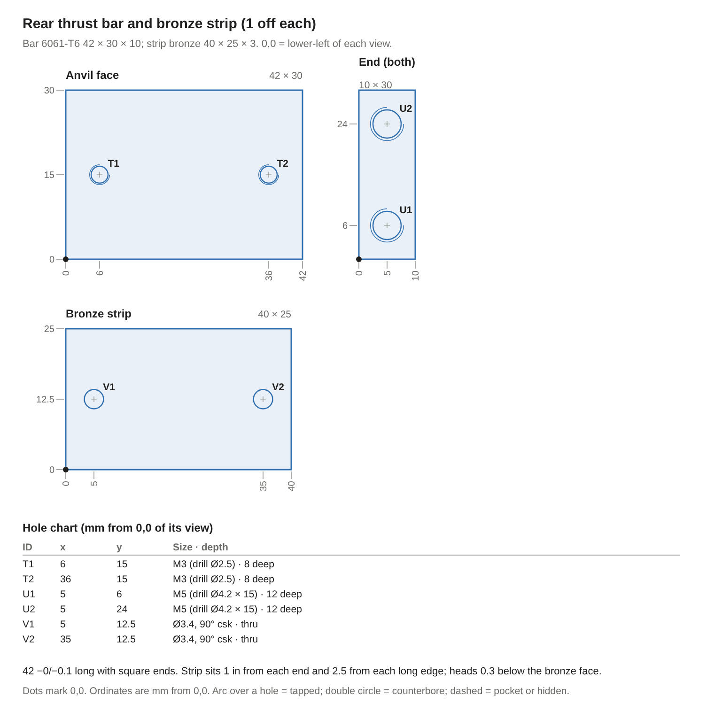

Thrust bar: 6061 10 × 30 flat, saw 44, mill to 42 −0/−0.1 × 30 × 10 with square ends. Bronze strip: 3 mm bronze, cut and file to 40 × 25.

*Anvil face* (42 × 30)

| Hole | X | Y | Size | Depth | Program |
| --- | --- | --- | --- | --- | --- |
| T1 | 6 | 15 | M3 (drill Ø2.5) | 8 deep | O1701 |
| T2 | 36 | 15 | M3 (drill Ø2.5) | 8 deep | O1701 |

*End (both)* (10 × 30)

| Hole | X | Y | Size | Depth | Program |
| --- | --- | --- | --- | --- | --- |
| U1 | 5 | 6 | M5 (drill Ø4.2 × 15) | 12 deep | O1702 |
| U2 | 5 | 24 | M5 (drill Ø4.2 × 15) | 12 deep | O1702 |

*Bronze strip* (40 × 25)

| Hole | X | Y | Size | Depth | Program |
| --- | --- | --- | --- | --- | --- |
| V1 | 5 | 12.5 | Ø3.4, 90° csk | thru | O1703 |
| V2 | 35 | 12.5 | Ø3.4, 90° csk | thru | O1703 |

1. **O1701** — thrust bar anvil face. Setup: Anvil face up, 42 along X. Z0 = anvil face. Tools T1, T10.
2. **O1702** — thrust bar end. Setup: Bar on end in the vise, 30 along Y, 10 along X. Z0 = end face. Tools T1, T12. Run it for each end.
3. **O1703** — bronze strip. Setup: Strip taped to a sacrificial plate, 40 along X. Z0 = top face. Tools T1, T11. Countersink V1 and V2 90° by hand, so the M3 × 8 heads sit 0.3 below the bronze face. Screw the strip to the bar, 1 in from each end and 2.5 from each long edge.

Notes from the drawing:

- 42 −0/−0.1 long with square ends. Strip sits 1 in from each end and 2.5 from each long edge; heads 0.3 below the bronze face.

### 8.8 Rear stop block (item 19)

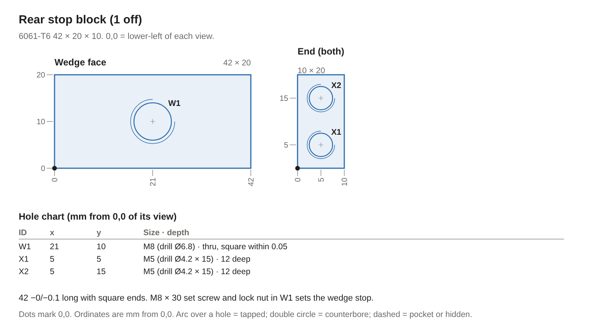

Stock: 6061 10 × 30 flat, saw 44, mill to 42 −0/−0.1 × 20 × 10 with square ends.

*Wedge face* (42 × 20)

| Hole | X | Y | Size | Depth | Program |
| --- | --- | --- | --- | --- | --- |
| W1 | 21 | 10 | M8 (drill Ø6.8) | thru, square within 0.05 | O1801 |

*End (both)* (10 × 20)

| Hole | X | Y | Size | Depth | Program |
| --- | --- | --- | --- | --- | --- |
| X1 | 5 | 5 | M5 (drill Ø4.2 × 15) | 12 deep | O1802 |
| X2 | 5 | 15 | M5 (drill Ø4.2 × 15) | 12 deep | O1802 |

1. **O1801** — stop block. Setup: Wedge face up, 42 along X. Z0 = wedge face. Tools T1, T18. Tap W1 M8 square within 0.05, using the spindle as a guide.
2. **O1802** — stop block end. Setup: Block on end, 20 along Y, 10 along X. Z0 = end face. Tools T1, T12. Run it for each end.

Notes from the drawing:

- 42 −0/−0.1 long with square ends. M8 × 30 set screw and lock nut in W1 sets the wedge stop.

### 8.9 Float lugs (item 20, two off)

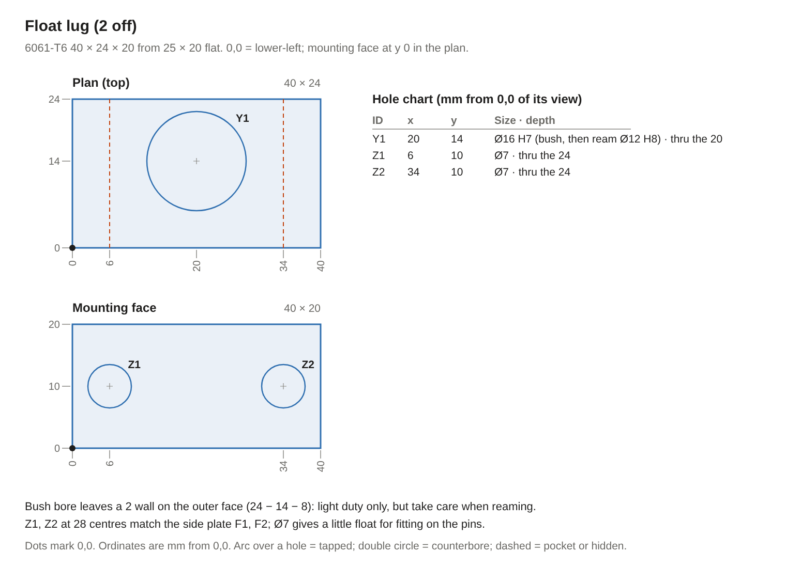

Stock: 25 × 20 flat 6061-T6. Saw 2 × 42 and mill to 40 × 24 × 20.

*Plan (top)* (40 × 24)

| Hole | X | Y | Size | Depth | Program |
| --- | --- | --- | --- | --- | --- |
| Y1 | 20 | 14 | Ø16 H7 (bush, then ream Ø12 H8) | thru the 20 | O1901 |

*Mounting face* (40 × 20)

| Hole | X | Y | Size | Depth | Program |
| --- | --- | --- | --- | --- | --- |
| Z1 | 6 | 10 | Ø7 | thru the 24 | O1902 |
| Z2 | 34 | 10 | Ø7 | thru the 24 | O1902 |

1. **O1901** — float lug bore. Setup: Top (40 x 24) face up, 40 along X, mounting face toward −Y (Y0 on the mounting face). Z0 = top face. Tools T1, T18, T3. It helix-mills the bore to 15.8. Then, in the same setting, ream Ø16 H7 on the manual mill, or bore it with a boring head if you have no 16 reamer. Press in the bush and ream it Ø12 H8 to suit the guide pins.
2. **O1902** — float lug mounting holes. Setup: Mounting (40 x 20) face up, 40 along X. Z0 = mounting face. Tools T1, T19.

Notes from the drawing:

- Bush bore leaves a 2 wall on the outer face (24 − 14 − 8): light duty only, but take care when reaming.
- Z1, Z2 at 28 centres match the side plate F1, F2; Ø7 gives a little float for fitting on the pins.

### 8.10 Roof wear plate

See 7.3. It is hardened, so it is covered with the hardened parts.

### 8.11 Roller cages (item 12, two off) — 2 mm brass

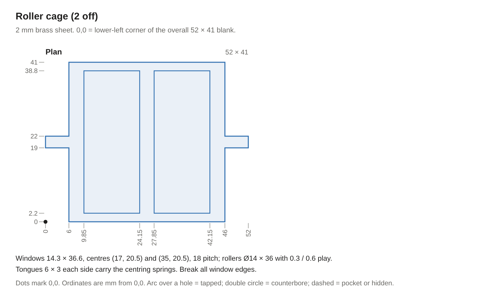

Stock: 2 mm brass sheet, two blanks 56 × 45. Tape each blank to a flat sacrificial plate with double-sided tape, and add two clamps outside the outline.

| Feature | X | Y | Size | Program |
| --- | --- | --- | --- | --- |
| Z1 window | 9.85–24.15 | 2.2–38.8 | 14.3 × 36.6, dog-bone corners | O2001 |
| Z2 window | 27.85–42.15 | 2.2–38.8 | 14.3 × 36.6, dog-bone corners | O2001 |
| Outline with tongues | 0–52 | 0–41 | 52 × 41, tongues 6 × 3 at Y 19–22 | O2001 |

**O2001** — roller cage. Setup: Brass blank 56 x 45 taped to a sacrificial plate; X0 Y0 at the lower-left of the 52 x 41 outline (the blank overhangs 2 mm each side). Z0 = top face. Tools T2. The windows have dog-bone corners: a Ø14 roller needs square corners, and a 6 mm cutter leaves R3, so the path relieves each corner on the diagonal. The outline is cut with the cutter outside, so the inside corners at the tongue roots come out R3. File them square.

Hand operations: break all window edges and check that each Ø14 × 36 roller drops in with 0.3 / 0.6 play. Fit the cross pins (6.6) and e-clips at assembly.

Notes from the drawing:

- Windows 14.3 × 36.6, centres (17, 20.5) and (35, 20.5), 18 pitch; rollers Ø14 × 36 with 0.3 / 0.6 play.
- Tongues 6 × 3 each side carry the centring springs. Break all window edges.

## 9. Assembly

Assemble in this order: 9.1 head preparation, 9.2 housing build on the bench, 9.3 spindle parts, 9.4 housing onto the machine, 9.5 cylinder. Section 11 then sets everything up. Clean every part, and deburr every hole and edge, before it goes in. Torques are in section 12.

### 9.1 Head preparation and base plate

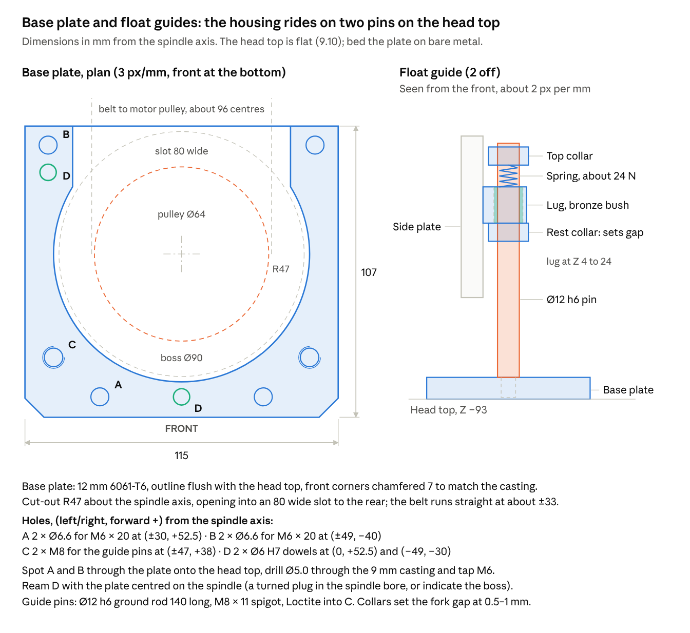

1. Take off the belt cover and its four posts. Scrape the paint from the head top under the base plate's footprint, so the plate beds on bare iron.
2. Turn a centring ring on the lathe: bore Ø90 to fit the spindle boss, OD Ø94 to fit the plate's R47 cut-out, about 4 high. Measure the boss first and bore the ring to suit.
3. Set the base plate on the head with the ring locating it, front edge to the front. The boss centre (the spindle axis) is at X 57.5, Y 60 from the plate's front-left corner (0,0, the 8.3 drawing datum): the centre of the R47 cut-out, so 57.5 in from each side edge and 60 back from the front edge. Without the ring, set those two distances from the boss's outside diameter: the edge of the Ø90 boss sits 15 behind the plate's front edge (60 − 45) and 12.5 in from each side edge (57.5 − 45). Spot A1, A2, B1 and B2 through onto the head with a transfer punch or a 6.6 drill.
4. Lift the plate off. Drill Ø5.0 through the 9 mm casting top and tap M6. Grease the drill and vacuum the chips: the belt and pulleys are underneath. Pilot Ø3 first if you are unsure what is below (section 4).
5. Screw the plate down with 4 × M6 × 20, ring still in place. Drill D1 and D2 Ø5.8 through the plate and 8 deep into the head (8 + 12 = 20 from the plate top), then ream Ø6 H7. Fit the two Ø6 dowels and remove the ring.
6. Screw the guide pins (6.5) into C1 and C2 with retaining compound, shoulder tight on the plate. Check they are vertical with a square on the table: within 0.05 over 100. Slide on the rest collars and set them low for now.

### 9.2 Housing build (on the bench)

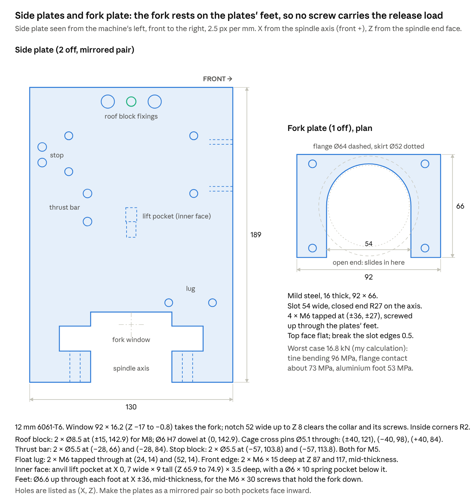

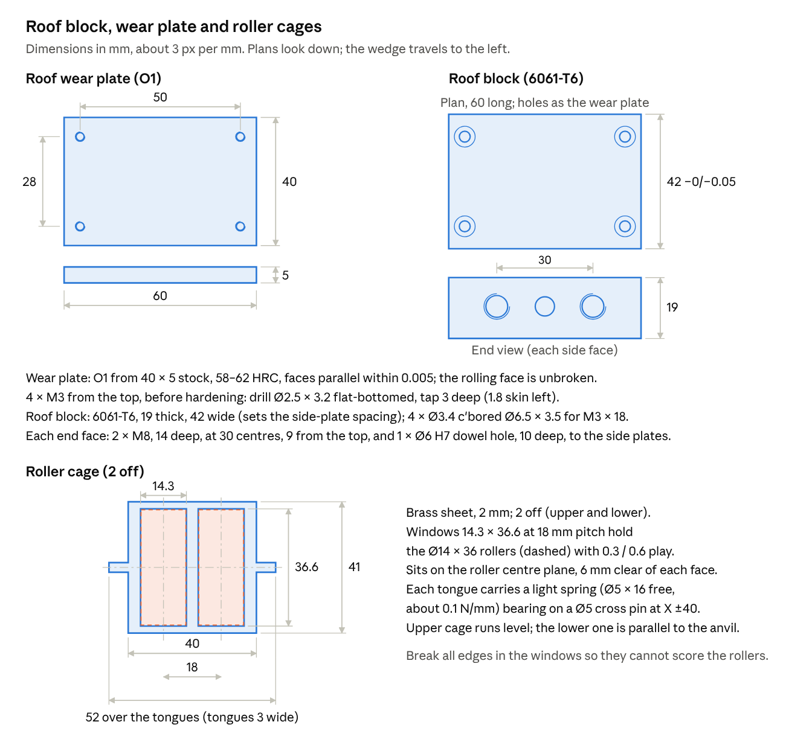

Build the housing lying on its side, in this order. The anvil's lift pins stand 4 mm proud each side, so they cannot go in once both plates are on.

| Step | Part | Check |
| --- | --- | --- |
| a | Lay the LEFT side plate down, inner face up | Pockets G1 and G2 facing up |
| b | Anvil, with its two lift pins in that plate's G1 pocket, and a lift spring in the G2 slot under the pin | Anvil moves down freely against the spring |
| c | Thrust bar with its bronze strip facing the anvil; M5 screws through the plate into U1 and U2, finger-tight | Bronze face square to the anvil's thrust face |
| d | Lower roller cage with its two rollers, on the anvil slope | Rollers turn freely in the windows |
| e | Wedge, with the JA stud already screwed into WE1 and locked, on the lower rollers | Thin end toward the rear |
| f | Upper roller cage and rollers on the wedge top |  |
| g | Wear plate screwed to the roof block (4 × M3 × 18), then the roof block on top of the upper rollers | Wear plate face clean and oiled |
| h | RIGHT side plate, catching the anvil's other lift pin in its G1 pocket | Plates parallel; nothing binds |
| i | Stop block between the plates at the rear, with its M8 × 30 hard-stop screw and lock nut (screw backed right off) |  |
| j | Fit all the M8 (roof block) and M5 (thrust bar, stop block) screws finger-tight. Ream Ø6 H7 through each side plate's B1 into the roof block's R1, plate and block together. Fit the two Ø6 dowels, then tighten everything | Housing square: check the diagonals across the plates' top edges |
| k | Four cage cross pins (6.6) through the plates, with the cage springs and e-clips | Each cage centres itself when the wedge is pushed and released |

Hand check before going on: push the wedge through its full 15 mm stroke by hand, through the JA stud. It must run smoothly and come back under the cage springs, with no tight spots. The anvil should rise 1 mm on its lift springs when the wedge is back.

### 9.3 Spindle parts — collet, collar, drawbar and stack

1. **Collet.** Measure the flat-nose collet's clamped stick-out (section 4); it should be 1.5 or less. Grind it only if it is not. Clean the spindle taper; anti-seize the collet's outside and threads.
2. **Collar.** Fit the two halves round the spindle and slide the collar down the spline until the shoulder sits on the spindle end face. Torque the six M8 × 25 12.9 screws evenly to 32 Nm in a cross pattern, keeping both joint gaps equal. Scribe a witness line across the collar and the spindle.
3. **Drawbar and stack.** With a TTS holder in the collet, thread the drawbar through the collar's Ø12.05 centring hole and fully into the collet; record the turns. Fit the base (3 mm) thrust washer on the collar seat, then the 8 Belleville washers in series (alternating), greased with MoS₂, then the top (4 mm) thrust washer and the preload nut.
4. **Preload.** Measure the washers' free height, then tighten the nut until the stack measures 8 × (free height − 0.35) between the thrust washers: about 20.4. As a cross-check, that is about 2.2 turns past hand-tight. Fit and lock the jam nut, then screw on the push pad. Check the holder flange is down on the spindle nose: a 0.02 feeler must not enter.

### 9.4 Housing onto the machine

1. Screw the two float lugs loosely to the side plates' F1 and F2 holes (M6), bushes on the guide-pin side.
2. Lower the housing onto the guide pins, anvil clear of the push pad. Slide the fork plate in sideways through both side-plate windows, under the collar flange, chamfered ends first. Fit its four M6 screws up through the side-plate feet (J holes) into K1–K4.
3. Raise the rest collars until the fork-to-flange gap is 0.5–1 mm on feelers. Tighten the lug screws with the housing hanging free on the pins, so the lugs line up with the pins.
4. Fit the hold-down springs above the lugs and the top collars.
5. Turn the spindle by hand: nothing may touch. Check the anvil sits about 1 mm above the push pad.

### 9.5 Cylinder

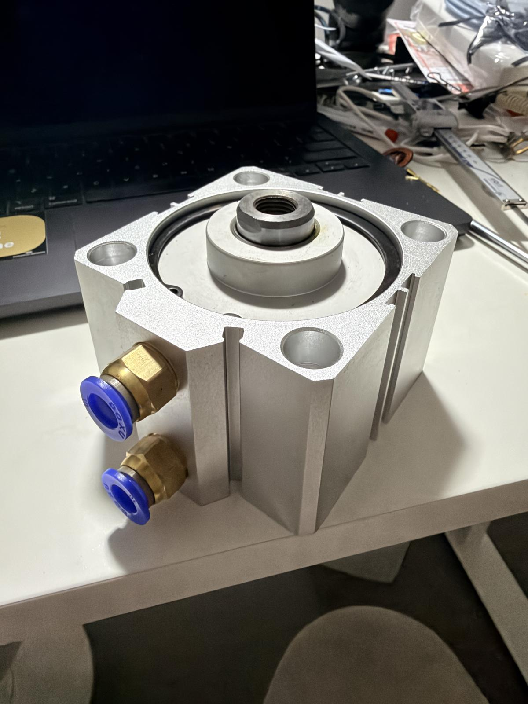

1. Screw the JA joint's socket onto the M14 stud in the cylinder rod until it bottoms, back it off 1–2 turns, and lock it with thread adhesive (SMC instructions).
2. Measure the JA joint gap (hold point M7, section 4). If it is over 30, make the four spacer tubes (6.7).
3. Offer the cylinder up with the wedge retracted. Screw the joint's male stud into the wedge's JA nut and lock it. Bolt the cylinder to the mount plate with 4 × M12 (35 + spacer length) into its front threads.
4. Fix the mount plate to the side plates' front edges with 4 × M6 × 25 into the Helicoil inserts (H1, H2 on each plate). If the N holes do not line up, open them to Ø7.
5. Push the wedge by hand through the cylinder rod (no air): the full stroke must still be smooth. Ports face the machine's left.

## 10. Pneumatics, electrical and gas strut

The circuit is fail-safe by design. The valve is single-solenoid with spring return, so the tool stays clamped unless air, 24 V and a release signal are all present and the spindle is stopped. Losing any one of them leaves the cylinder retracted and the washers clamping.

### 10.1 Air

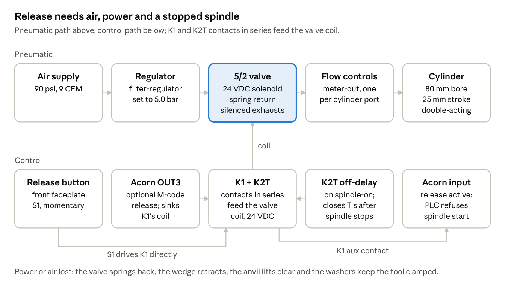

| Part | Where | Fitting notes |
| --- | --- | --- |
| Filter-regulator with gauge | On the column or stand, gauge visible | Set to 3 bar for first release (11.2), then 5.0 bar for service |
| 5/2 valve, single solenoid, spring return, 24 VDC, 1/4 BSP (ordered) | Head's left side, next to the cylinder ports | DIN coil plug with LED and suppression |
| Flow controls, meter-out | One on each cylinder port, or speed-control silencers on the valve exhausts | Start closed, then one turn open |
| Silencers | Both valve exhausts | Point them away from the operator |
| 10 mm PU tube, push-in fittings | Supply: regulator to valve. Two short lines: valve to cylinder |  |

Routing:

- The cylinder rides on the floating housing, which moves with the head through 240 mm of Z and lifts about 1 mm on release. Keep the two valve-to-cylinder lines short, with a small slack loop for the float.
- Run the supply from the regulator to the valve with a loop, or in a drag chain, long enough for full Z travel at both ends.
- Port A (de-energised, pressurised) goes to the cylinder's retract port. Port B (energised) goes to the extend port. Check this before the first test: with air on and no power, the rod must be pulled in.
- No lubricator. Once air has been lubricated it must stay lubricated, and the cylinder comes pre-greased.

Each release uses under 1 L of free air, so the 10 mm tube is far more than enough. Release speed is set by the valve and the flow controls.

### 10.2 Control wiring (draft)

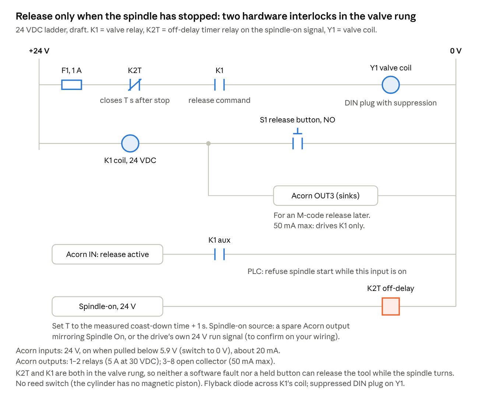

| Item | Function | Notes |
| --- | --- | --- |
| K1 relay | Switches the valve coil | Driven by the release button S1, and later by an Acorn open-collector output (OUT3) for an M-code release. The Acorn outputs 3–8 are 50 mA maximum, so they cannot drive the coil directly |
| K2T off-delay timer relay | Spindle-on interlock | Its contact opens the moment the spindle starts and recloses only after the coast-down time. In series with K1 in the coil circuit |
| K1 auxiliary contact | "Release active" to a spare Acorn input | The PLC uses it to refuse a spindle start while the tool is released |
| S1 release button | Manual release | Works through the hardware rungs even if the PLC has faulted |
| Fuse | In the 24 V feed to the coil circuit | Size it to the coil current from the coil label |

Before wiring, fill in the TBD items in section 4: the spare input and output terminals, where to take a 24 V spindle-on signal without loading the drive's run input, the coast-down time from 5000 rpm (set K2T a little longer), and the coil current against the spare 24 V output. The coil cable follows the air supply line and enters the casting through the front faceplate with the button wiring.

Acorn logic, as functions (the CNC12 menu names are not in Centroid's public documentation):

1. While "release active" is on, refuse a spindle start and show "drawbar released".
2. If "release active" comes on while the spindle is commanded on, stop the spindle and raise a fault.
3. Later: an M-code turns OUT3 on only when the spindle is commanded off and a timer at least as long as K2T has run; the clamp M-code, or a 10 s timeout, turns it off.

### 10.3 Z-axis gas strut — hold point M9

The drawbar adds about 6.4 kg (about 63 N) to the head, less the belt cover and posts that come off. The brackets are not yet designed. Do this after the housing is fitted:

1. Undo the Z motor coupling. Hang the head from a luggage scale and read the force just as it starts to rise and just as it starts to fall. The average, W, cancels the slide friction.
2. Choose a gas spring with at least 250 mm of stroke (the SX2.3 manual gives 240 mm of headstock travel) and an extended rating of about 0.7 W. Buy one with a bleed valve, charged a little above that.
3. Mount it so it is longest with the head at the bottom, rod down if the brackets allow.
4. Bleed it down on the machine until the head just settles under its own weight at the top of its travel. The head must never rise on its own if the Z drive loses power.

## 11. Commissioning

Set things in this order: collet, collar, preload, gaps, hard stop, then air. Each step fixes a reference that the next one measures from. Steps 1–4 are in 9.3 and the gaps are in 9.4. Record each result on the measurement sheet.

With 8 washers and a 1.2 mm stroke, the tool should release at about 4.5 bar. A much higher figure means friction, the wrong preload, or a sticking collet.

### 11.1 Hard stop (no air)

1. Put a dial indicator on the push pad, reading the drawbar's downward movement.
2. Push the wedge rearward by hand through the cylinder rod, or with a lever on the JA joint. Note where the anvil first touches the push pad (the indicator starts to move).
3. Set the stop screw in the stop block so the drawbar moves **s\_r + 0.3** beyond first contact (s\_r from hold point M5), and **never more than 1.9**, or the washers go flat. The wedge moves about 6 times the drawbar movement, so 1.5 at the drawbar is about 9 mm more wedge travel.
4. Lock the stop screw's nut. Re-check the reading.

### 11.2 Air and first release

1. Close both flow controls, then open each one turn. Set the regulator to 3 bar.
2. Press release. At 3 bar nothing should happen: the cylinder cannot beat the preload. If the tool drops, the preload is low, so go back to 9.3 step 4.
3. Raise the pressure in 0.5 bar steps until the holder drops freely. Record the pressure: about 4.5 bar is expected.
4. Set the regulator to 5.0 bar for service, about 0.5 bar above the release pressure. This also caps the collar load if a collet ever sticks.
5. Adjust the flow controls until extend and retract are each smooth, about half a second, with no slam into the stop (my suggestion).

### 11.3 Interlock and fail-safe checks

| Test | Expected |
| --- | --- |
| Spindle running; press release | Nothing happens |
| Spindle just stopped from 5000 rpm; press release | Blocked until the K2T delay ends |
| Released; try to start the spindle | Acorn refuses ("drawbar released") |
| Cut power to the valve mid-release | Cylinder retracts; tool clamps |
| Shut off the air mid-release | Washers clamp the tool |

### 11.4 Run-in and checks

- Cycle 50 tool changes. Check the collar witness line, the stack height and the holder seating (a 0.02 feeler must not enter).
- Touch off the same tool 10 times, with a change between each. The spread is your tool-length repeatability.
- Check the roller cages are still centred.
- After two weeks, re-measure the stack and reset it to height: stacks lose about 5 % of force in the first two weeks (Surisa).
- Monthly: inspect the washers for cracks and replace any damaged one at once. Re-grease between washers every 5,000 cycles or six months (Tormach). Check the witness line.
- Treat the spindle collet as a wear part: replace it when holders stop dropping out freely.

### 11.5 Going back to a manual drawbar

Undo the four fork screws, slide the fork out and lift the housing off its guide pins. The stack still clamps the tool, but a tool cannot then be released by hand: it takes about 12 kN at the push pad. To use the mill manually, take off the push pad, jam nut and preload nut, lift out the stack and drawbar, unclamp the collar, and fit a plain M12 × 1.75 manual drawbar (or the original collet with the original 7/16-20 drawbar). The base plate and guide pins can stay.

## 12. Appendices

### 12.1 G-code program index and travel spans

The programs are in the repo's `gcode/` folder, as `O####_name.nc`. All are G21 mm, absolute, G54, with the work zero at the lower-left of the view and Z0 on the face named. They were generated by `manual/gcode_gen.py`. To change a feed or a tool, edit the generator and re-run `python3 gcode_gen.py ../gcode` from inside `manual/`, rather than editing the .nc files. `manual/backplot.py` draws an XY back-plot of any program for checking.

The spans are the extremes of the tool centre, relative to G54. Before running a program, check that G54 plus each span, plus the cutter radius, is inside your CNC12 soft limits. That is easiest with the part placed near the middle of the table. I could not find a published X/Y travel figure for the SX2.3 CNC conversion to check them against, so use your own machine's limits.

| Program | Part / operation | Section | Material | Tools | X span | Y span | Z0 |
| --- | --- | --- | --- | --- | --- | --- | --- |
| O1101 | Side plate holes, stacked pair | 8.1 | Aluminium | T1, T20, T16, T14, T15, T13 | 8 to 117 | 51 to 179.9 | Top face of the stack |
| O1102 | Side plate window and notch | 8.1 | Aluminium | T2 | 22 to 108 | −6 to 42 | Top face of the plate |
| O1103 | Side plate lift and spring pockets | 8.1 | Aluminium | T2 | 64.5 to 65.5 | 95.9 to 108.9 | Inner face |
| O1201 | Fork plate | 8.2 | Steel | T1, T13, T3 | 10 to 82 | −6 to 60 | Face as clamped |
| O1301 | Head-top base plate | 8.3 | Aluminium | T1, T17, T18, T16, T3 | −6 to 121 | −6 to 113 | Top face |
| O1401 | Cylinder mount plate | 8.4 | Aluminium | T1, T17, T18, T3 | 11.47 to 88.53 | 11.47 to 88.53 | Top face |
| O1501 | Roof block top face | 8.5 | Aluminium | T1, T11, T2 | 4.75 to 55.25 | 6.75 to 35.25 | Top face |
| O1502 | Roof block side face | 8.5 | Aluminium | T1, T18, T16 | 15 to 45 | 10 | Side face as clamped |
| O1601 | Roof wear plate | 7.3 | Steel | T1, T10 | 5 to 55 | 6 to 34 | Top face |
| O1701 | Thrust bar anvil face | 8.6 | Aluminium | T1, T10 | 6 to 36 | 15 | Anvil face |
| O1702 | Thrust bar end | 8.6 | Aluminium | T1, T12 | 5 | 6 to 24 | End face |
| O1703 | Bronze strip | 8.7 | Brass | T1, T11 | 5 to 35 | 12.5 | Top face |
| O1801 | Stop block | 8.8 | Aluminium | T1, T18 | 21 | 10 | Wedge face |
| O1802 | Stop block end | 8.8 | Aluminium | T1, T12 | 5 | 5 to 15 | End face |
| O1901 | Float lug bore | 8.9 | Aluminium | T1, T18, T3 | 17.1 to 22.9 | 11.1 to 16.9 | Top face |
| O1902 | Float lug mounting holes | 8.9 | Aluminium | T1, T19 | 6 to 34 | 10 | Mounting face |
| O2001 | Roller cage | 8.11 | Brass | T2 | −3 to 55 | −3 to 44 | Top face |
| O2101 | Wedge underside slope | 7.1 | Steel | T3 | −5 to 85 | −7 to 47.6 | Top of the blank (24.1 above the parallels) |
| O2102 | Wedge trailing end hole | 7.1 | Steel | T1, T18, T21 | 20.3 | 12.05 | Trailing end face |
| O2201 | Anvil top slope | 7.2 | Steel | T3 | −5 to 45 | −7 to 47.6 | Top of the blank (23.3 above the parallels) |
| O2202 | Anvil lift pin holes | 7.2 | Steel | T1, T22 | 20 | 8.3 | Side face |

The largest spans are O1301 (127 × 119, because the chamfer and cut-out paths start 6 outside the blank) and O1101 (109 × 129). If your table cannot reach it in one setting, split the program at the tool changes, or move G54 and re-pick.

### 12.2 Fasteners and torques

| Joint | Fastener | Into | Torque (N·m) | Notes |
| --- | --- | --- | --- | --- |
| Collar clamp | 6 × M8 × 25, 12.9 | 4140 collar half | 32 | Design value; cross pattern, joint gaps equal |
| Drawbar preload | 7/16-20 nut and jam nut | Drawbar | By stack height, not torque | 20.4 between the thrust washers (9.3) |
| Cylinder to mount plate | 4 × M12 × (35 + spacer), 8.8 | Cylinder's aluminium body, 9 engaged | 40 | My judgement: limited by the aluminium thread |
| Mount plate to side plates | 4 × M6 × 25 | M6 Helicoil, 6060 | 8 |  |
| Roof block to side plates | 4 × M8 × 25 | 6061 roof block | 18 |  |
| Wear plate | 4 × M3 × 18 | O1, about 5 threads | 1 | Locating only |
| Thrust bar, stop block | 8 × M5 × 20 | 6061, 12 deep | 4 |  |
| Bronze strip | 2 × M3 × 8 csk | 6061 thrust bar | 1 |  |
| Hard stop | M8 × 30 set screw and nut | 6061 stop block | Lock nut 15 | Set by measurement (11.1) |
| Fork plate | 4 × M6 × 30 | Mild steel fork, 12 thread | 10 | Up through the side-plate feet |
| Float lugs | 4 × M6 × 35 | 6060 side plates (F holes) | 8 | Tighten with the housing hanging on the pins |
| Base plate | 4 × M6 × 20 | Cast iron head, 8 engaged | 9 |  |
| Guide pins | M8 spigot | 6060 base plate | 15, with retaining compound | Shoulder tight on the plate |
| JA joint | M14 × 1.5 stud and socket | Rod; wedge | Per SMC: socket to bottom, back off 1–2 turns, thread adhesive |  |

Only the collar torque is a design value. The rest are my judgement: they are about 70 % of typical dry torques for 8.8 screws (VDI 2230-style tables, from memory), lowered for tapped aluminium and cast-iron threads. Use a torque wrench on the collar; elsewhere, firm by hand with a short key is close enough.

### 12.3 Bought hardware

The full list, with order status, is in the design doc's hardware list (all ordered 6 Nov 2026 except the spacer tubes; the Tormach 31319 washers were ordered 14 Nov 2026 and are awaiting delivery). The parts this manual fits are: M8 × 25 12.9 (6 + 2), 7/16-20 nut and jam nut, M14 × 1.5 × 40 stud and thin nut, M12 cylinder screws (4), M6 × 25 (4), M8 × 25 (4), Ø6 m6 × 20 dowels (2), M3 × 18 (4), M5 × 20 (8), M3 × 8 csk (2), M8 × 30 set screw and nut, M6 × 30 (4), M6 × 35 (4), M6 × 20 (4), Ø6 m6 × 16 dowels (2), Ø5 m6 × 10 dowels (2), Ø12 shaft collars (4), Ø12 × Ø16 × 20 bronze bushes (2), hold-down springs (2), cage springs (4), anvil lift springs (2), DIN 6799 e-clips for Ø5 (8), M6 Helicoil inserts (4), and optionally M8 Helicoil inserts (4).

### 12.4 References

- SX2\_3\_Drawbar repo: design doc, measurement sheet, calculator and drawings (github.com/rbrett/SX2\_3\_Drawbar).
- [Atlas Steels 4140 datasheet](https://atlassteels.com.au/wp-content/uploads/2021/09/Through-Hardening-Low-Alloy-Steel-Bar-4140-Grade-Data-Sheet-10-09-21-1.pdf): supply condition, hardening 850–860 °C oil, temper 175–230 °C, avoid 230–370 °C.
- [voestalpine Australia 4140 datasheet](https://www.voestalpine.com/highperformancemetals/australia/app/uploads/sites/265/2024/08/Datasheet-4140-2026-v2.pdf): hardening 830–860 °C, oil; HT supply 269–331 HB.
- [Hudson Tool Steel O1 data](https://hudsontoolsteel.com/technical-data/steelO1): preheat 649–704 °C, harden 802–816 °C, quench and temper 177–204 °C.
- [SMC JA floating joint catalogue](https://static.smc.eu/pdf/JA-A_EU.pdf): JA40-14-150 rating and installation.
- [Tormach power drawbar maintenance](https://docs.tormach.com/Content/Online-Only/power_drawbar_maintenance.htm): washer greasing interval.
- [Surisa DIN 2093 disc springs](https://www.surisa.es/en/collections/disc-springs-din-2093): relaxation in the first two weeks.
- [SX2.3 manual (EN)](https://www.sieg-machines.de/mediafiles/Sonstiges/SX2.3%20manual%20EN.pdf): headstock travel 240 mm.
- Johnson, K. L., *Contact Mechanics*, 1985: roller contact yield (cited from memory).
